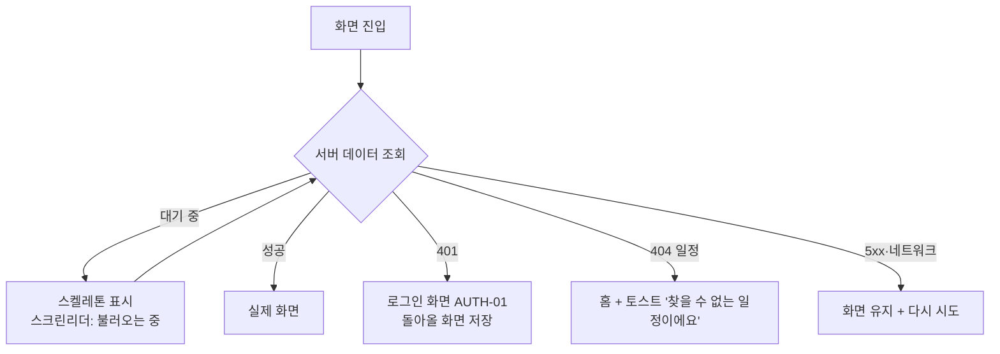

# SKELETON_SPEC.md — 불러오는 중(Skeleton) 화면 명세서

- 작성일: 2026-11-15
- 대상 저장소: snsg-fr (브랜치 `feature/SHI-188-skeleton`, 기준 커밋 `18b2738`)
- 성격: **SHI-188 구현 범위와 확인 기준.** 스켈레톤 도입·펄스·200ms 표시 지연은 사용자 지시로 승인됨(2026-11-15). 구현과 자동 검증은 끝났고 실제 화면·기기 확인은 사용자 확인 대기다.
- 표기: `✅` 문서·코드로 확인됨 · `⚠️ 확인 필요` 근거 없음 또는 문서끼리 충돌(추측해서 채우지 않음) · `TODO(D-5)` 기존 문서의 미정 질문 ID

---

## 0. 이 문서가 다루는 범위와 해석

### 0.1 "Skeleton"의 뜻 — 해석 근거
SHI-188의 Skeleton은 **"데이터를 불러오는 동안 화면 모양을 흉내 낸 자리 표시(로딩 스켈레톤) UI"**를 뜻한다.

| 근거 | 위치 |
|---|---|
| 작업 브랜치 이름이 `feature/SHI-188-skeleton` | `git branch` |
| 작업 중(미커밋) 변경: `Skeleton.tsx`, `ProfileSkeleton.tsx`, `CreateListSkeleton.tsx`, `ScheduleDetailSkeleton.tsx`, `ScheduleListSkeleton.tsx` 신규, 색 토큰 `--skeleton` 추가 | `git status` |
| 코드 주석에 `SHI-188`, `D-5` 언급 | `src/shared/ui/Skeleton.tsx` 외 |

✅ 사용자 지시(2026-11-15): 기존 진행분의 로딩 스켈레톤 추가를 승인했다.

### 0.2 분석한 자료와 한계

| 자료 | 상태 |
|---|---|
| `AGENTS.md`, `CLAUDE.md` | ✅ 읽음 |
| `.claude/rules/*` (6개), `.claude/skills/*` (6개), `.claude/agents/requirements-analyst.md` | ✅ 읽음 (skills는 `verify`·`feature` 위주, 나머지는 제목·용도만) |
| `.claude/tasks/SHI-*.md` | `SHI-186`, `SHI-188` 확인. SHI-188의 세부 화면 범위는 이 문서 기준 |
| `docs/` (HANDOFF, PLAN, DESIGN, USER_FLOW) | ✅ 로딩·상태·공통 컴포넌트·화면 관련 절 읽음. `TECH_STACK.md`, `DEPLOY_LOG.md`는 필요한 부분만 확인 |
| 현재 코드 | ✅ 스켈레톤 관련 신규·변경 파일 전부 확인 |
| **Figma 디자인 자료** | ⚠️ **이 세션에서 Figma 도구에 접근할 수 없어 직접 보지 못했다.** `docs/DESIGN.md`가 기록한 Figma(FigJam `pfVZnQY81EM6AUQt3H6tKs`) 분석 결과로 대신했다. 그 기록에 따르면 **Loading 상태는 보드 전체에서 디자인이 확인되지 않는다**(DESIGN §11, §14) |

---

## 1. 요약

- Loading 시안은 **없다**(DESIGN §11·§14). 사용자는 2026-11-15 SHI-188 스켈레톤 도입과 펄스를 승인했다. 스켈레톤은 기존 화면 배치를 닮게 하고, 모션 감소 설정에서는 애니메이션을 멈춘다.
- 사용자 결정은 `.claude/rules/ui.md`, `DESIGN.md`, `USER_FLOW.md`, `PLAN.md`, `HANDOFF.md`에 반영했다. 스켈레톤 색 값은 시안이 아닌 임시 토큰이며 D-4가 남아 있다.
- 7개 기능별 스켈레톤을 공통 `Skeleton`/`SkeletonGroup`으로 구성해 8개 화면·하위 영역에 연결했다. `SkeletonGroup`은 자리와 화면 읽기 도구 안내(`role="status"`)를 처음부터 그리고, 200ms 동안 투명했다가 보인다(CSS `animate-skeleton-appear`). 그래서 빠른 응답에서는 번쩍이지 않고 배치도 밀리지 않는다. 데이터가 오면 즉시 사라진다. 데이터 조회가 아닌 처리·하이드레이션 대기와 다음 페이지 버튼은 기존 텍스트를 유지한다.
- 공통 `Skeleton` Storybook Story와 E2E가 추가됐다. 표시 지연 변경 뒤 자동 검증도 통과했다.

---

## 2. 화면별 요구사항

각 행은 "현재 상태"(요청 경로 작업 사본 기준)와 "스켈레톤 요구사항"이다. 요구사항은 **기존 실제 화면의 배치를 그대로 흉내 내는 것**만 근거로 삼았고, 새 디자인은 만들지 않는다(`ui.md`: 디자인에 없는 UI 추가 금지).

### 2.1 스켈레톤 적용 대상 (구현됨)

| # | 화면 ID | 화면 / 경로 | 로딩 시점 | 현재 구현 | 요구사항(배치) |
|---|---|---|---|---|---|
| S1 | LIST-01·04·05 | 홈 일정 목록 `/` (탭: 모집 중·참여한·개설한) | 탭 안 목록 첫 조회 중 | `ScheduleListSkeleton` (카드 3장) in `ScheduleListPanel` | 실제 `ScheduleCard`와 같은 크기·간격. 헤더·탭·필터 칩·GNB는 실제 UI 유지, 목록 자리만 대체 |
| S2 | DTL-01~08, HOST-01·02 | 일정 상세 `/schedules/[id]` | 상세 조회 중(오류·404 아님) | `ScheduleDetailSkeleton` | 헤더는 실제 헤더. 본문: 상태·활동 태그, 개설자 아바타·이름, 제목, 시작/소요/인원 3칸, 활동 소개, 참여자 요약, 장소(지도 영역 포함). **하단 버튼은 그리지 않는다**(역할별로 달라서, 코드 주석) |
| S3 | DTL-06·HOST-02 | 참여자 명단 펼침 | 명단 조회 중 | `ParticipantRowsSkeleton` (3줄) in `ParticipantSection` | 명단 한 줄(아바타 + 닉네임 + 보조 줄) 모양 3줄 |
| S4 | MY-01 | 내 정보 `/my` | `GET /users/me` 조회 중 | `MyProfileSkeleton` | 실제 헤더 유지. 프로필 카드(아바타, 이름 줄 3, 버튼) + 메뉴 카드 3줄 |
| S5 | MY-02 | 프로필 수정 `/my/edit` | 프로필 조회 중 | `ProfileFormSkeleton` | 사진 + 입력칸 5 + 하단 고정 CTA 자리 |
| S6 | AUTH-03 | 프로필 완성 `/signup` | 가입 세션 조회 중 | `ProfileFormSkeleton` + 제목 줄 Skeleton | S5와 같은 폼 배치 + 제목 자리 |
| S7 | CRT-01 | 일정 개설 1단계 활동 선택 `/create` | 활동 목록 조회 중 | `ActivityListSkeleton` (3줄) | `RadioList` 항목과 같은 높이 |
| S8 | CRT-02 | 일정 개설 2단계 장소 선택 (시트) | 지역·장소 조회 중 | `PlaceListSkeleton` (3줄) + 시트 제목의 매장 수 자리 | 장소 버튼 배치와 동일. 로딩 중 `0곳`으로 보이지 않게 숫자 자리만 Skeleton |

### 2.2 준비·이동 중 화면 (Q4, 사용자 결정 2026-11-16: 스켈레톤으로 통일)

| # | 위치 | 지금 | 비고 |
|---|---|---|---|
| T1 | `AuthCallback.tsx`, `app/auth/callback/page.tsx` | "로그인 처리 중..." 유지 | 로그인 콜백 화면은 SHI-187에서 같은 스켈레톤으로 정리 |
| T2 | `ScheduleDetailScreen` 404(`isNotFound`) → 홈 이동 중 | 상세 스켈레톤(실제 헤더 + 본문) | 불러오는 중과 같은 모양 |
| T3 | `CreateScheduleFlow` 기기 저장값 읽기 전(`!isClient`) | `PageSkeleton` | 화면 배치가 정해지기 전이라 공통 화면 스켈레톤 |
| T4 | `HomeScreenGuideScreen` 기기 판별 전(`!platform`) | `PageSkeleton` | 같음 |
| T5 | `ScheduleListPanel` `더 보기` 버튼 | 버튼 글자 "불러오는 중..." 유지 | 버튼 안 상태라 스켈레톤 대상 아님 |
| T6 | `app/page.tsx` `<Suspense>` | fallback 없음 | 주소 쿼리 읽는 아주 짧은 순간. 남은 질문 |

### 2.3 대상 외 (로딩 화면이 없는 것)
로그인(AUTH-01, 정적 화면), 필터 시트(LIST-03, 활동·지역 목록 로딩 방식은 ⚠️ 코드 미확인), 홈 화면 추가 안내(ONB, 정적), 접속 환경(ENV, ⏸ 보류), 알림함·댓글·제보(MVP 밖).

---

## 3. 사용자 흐름

스켈레톤은 **새 흐름을 만들지 않는다.** 기존 흐름(USER_FLOW §3, §10)의 "데이터 도착 전" 구간만 채운다.

### 3.1 공통 흐름 (조회 화면)

- ✅ 401·404·5xx 처리는 USER_FLOW §10 그대로다. 스켈레톤은 이 처리를 바꾸지 않는다.
- ✅ 서버가 판정하는 값(일정 상태, 참여 가능 여부 등)은 스켈레톤 단계에서 추정해 보여주지 않는다(AGENTS.md). 그래서 상세의 **하단 버튼 영역은 그리지 않는다.**

### 3.2 화면별 로딩 흐름

| 화면 | 흐름 |
|---|---|
| 홈 | 진입(항상 홈) → 헤더·탭·칩 즉시 표시 → 목록 스켈레톤 3장(대상 탭·필터에 캐시가 없을 때) → 카드 / 빈 상태 / 오류+`다시 시도`. 캐시가 있으면 목록을 유지하고 백그라운드에서 다시 받는다. |
| 상세 | 카드·공유 링크 진입 → 실제 헤더 + 본문 스켈레톤 → 상세. 로그인했는데 응답이 `GUEST`면 토큰 재발급 후 재조회(§7.2). 이 재조회 동안 스켈레톤을 다시 보일지 ⚠️ 확인 필요 |
| 명단 | `⌄` 펼침 → 줄 스켈레톤 3개 → 명단 / 실패 시 텍스트 + 다시 시도(디자인 없음 TODO(D-5)) |
| 내 정보 | GNB `내 정보` → 헤더 + 스켈레톤 → 프로필. 401·`404 USER_NOT_FOUND` → 로그인 화면(§8) |
| 프로필 수정 | `수정하기` → 헤더 + 폼 스켈레톤 → 폼 |
| 프로필 완성 | 로그인 콜백 → `/signup` → 폼 스켈레톤 → 폼. 가입 세션 만료 시 다시 로그인(F-13) |
| 일정 개설 | CRT-01 활동 목록 스켈레톤 → 선택 → CRT-02 장소 시트에서 지역·장소 스켈레톤 |

---

## 4. Skeleton 구현 범위

### 4.1 범위 안 (이번 이슈에 포함)

| 구분 | 내용 | 상태 |
|---|---|---|
| 공통 컴포넌트 | `shared/ui/Skeleton.tsx` (`Skeleton`, `SkeletonGroup`) | ✅ 작성됨 |
| 디자인 토큰 | `globals.css`에 `--skeleton: #e9ebe4`, `--color-skeleton` | ✅ 추가됨 (값은 근사치, D-4) |
| 기능별 스켈레톤 | 일정 목록 / 일정 상세·명단 / 개설 활동·장소 / 내 정보·프로필 폼 | ✅ 작성됨 |
| 화면 연결 | `ScheduleListPanel`, `ScheduleDetailScreen`, `ParticipantSection`, `MyProfileScreen`, `ProfileEditScreen`, `ProfileCompleteScreen`, `ActivityStep`, `PlaceStep` | ✅ 연결됨 |
| Storybook | `Skeleton.stories.tsx` | ✅ 추가됨 |
| E2E | 로딩 중 스켈레톤 확인 | ✅ 목록 지연 응답·빠른 응답 및 장소 오류 확인 |
| 문서 | `ui.md`·`DESIGN.md §11`·`USER_FLOW`·`PLAN.md`·`HANDOFF.md`·`.claude/tasks/SHI-188.md`에 스켈레톤 결정 반영 | ✅ 반영됨 |

### 4.2 범위 밖 (하지 않는다)
- Loading **디자인 신규 창작**(색 변경, 로고·일러스트, 화면별 고유 애니메이션)
- 오류·빈 상태 디자인(D-5, F-19 문구 미정)
- 알림·댓글·제보·ENV 화면
- 상세 하단 버튼 스켈레톤(서버 판정 값 추정 금지)
- 기기 감지 분기, 새 라이브러리 설치(`Skeleton`은 shadcn 방식 직접 구현. 라이브러리 추가 없음 ✅)
- 커밋·push·PR(사용자가 요청할 때만, AGENTS.md)

### 4.3 남은 확인
1. 200ms 안에 끝나는 요청에서 스켈레톤이 보이지 않는지, 더 오래 걸리는 요청에서는 보였다가 실제 내용으로 바뀌는지 화면에서 확인한다.
2. `--skeleton` 색은 시안 값이 아닌 근사치(D-4)다.

---

## 5. 공통 컴포넌트

### 5.1 이번 작업에서 만든 것

| 컴포넌트 | 파일 | 역할 | 비고 |
|---|---|---|---|
| `Skeleton` | `shared/ui/Skeleton.tsx` | 자리 표시 한 칸. `bg-skeleton` + `animate-pulse`, `motion-reduce:animate-none`, `aria-hidden`, 크기·모양은 `className` | ✅ 접근성: 모션 감소 설정 존중 |
| `SkeletonGroup` | 같은 파일 | 자리·안내는 처음부터 두고 200ms 동안 투명했다가 표시(CSS 애니메이션, JS 상태 없음). `role="status"` + `sr-only` "불러오는 중"을 **한 번만** 안내하며, 표시 뒤 최소 시간은 강제하지 않음 | 빠른 응답에서 깜박임 방지 |

### 5.2 기능 전용 컴포넌트 (shared로 올리지 않음 — `ui.md` "두 곳 이상에서 쓸 때만")

| 컴포넌트 | 파일 | 쓰는 곳 |
|---|---|---|
| `ScheduleListSkeleton` | `features/schedule/components/list/` | S1 |
| `ScheduleDetailSkeleton`, `ParticipantRowsSkeleton` | `…/detail/ScheduleDetailSkeleton.tsx` | S2, S3 |
| `ActivityListSkeleton`, `PlaceListSkeleton` | `…/create/CreateListSkeleton.tsx` | S7, S8 |
| `MyProfileSkeleton`, `ProfileFormSkeleton` | `features/profile/components/ProfileSkeleton.tsx` | S4, S5·S6 |

### 5.3 재사용하는 기존 컴포넌트
`BottomCta`(폼 스켈레톤 하단 자리), `AppHeader`/`MyProfileHeader`/`DetailHeader`(실제 헤더 유지), `RadioList`·`ScheduleCard`(배치 기준), `PageStatus`(T1~T4 유지, 삭제하지 않음).

### 5.4 컴포넌트 규칙 (`rules/ui.md`·`code-quality.md`에서)
- 스타일은 Tailwind **테마 토큰만**. 임의값(`bg-[#…]`, `p-[13px]`) 금지.
- `shared`는 `features`를 import하지 않는다.
- named export. `any` 금지. 주석은 "왜"만.
- 높이는 `dvh`, 폭은 `w-full` + 최대 폭 컨테이너, safe area 고려, 터치 영역은 해당 없음(비대화형).

---

## 6. Acceptance Criteria

AC는 "확인 방법 → 기대 결과" 형태. 코드·문서로 이미 확인된 항목은 ✅, 실행 확인은 ☐(아직 안 함).

### 6.1 공통

| ID | 기준 | 상태 |
|---|---|---|
| AC-C1 | 200ms 넘게 기다리는 S1~S8에서 기존 텍스트 "불러오는 중..." 대신 해당 영역에 스켈레톤이 보인다 | E2E ✅(S1 목록·S8 장소만) / 나머지 캡처 확인(2026-11-15 아티팩트) / 화면 ☐ |
| AC-C2 | 스켈레톤은 실제 화면과 **같은 영역·대략 같은 높이**를 차지해 데이터 도착 시 레이아웃이 크게 흔들리지 않는다 | 자동 검증 ☐ / 화면 ☐ |
| AC-C3 | 헤더·탭·필터 칩·GNB 등 데이터와 무관한 UI는 스켈레톤 중에도 실제로 보이고 동작한다 | 코드 ✅(S1·S2·S4·S5) / ☐ |
| AC-C4 | 스크린리더에 "불러오는 중"이 그룹당 **한 번** 읽히고, 개별 `Skeleton`은 읽히지 않는다 | 코드 ✅(안내 영역을 처음부터 그림) / VoiceOver ☐ |
| AC-C5 | 시스템 "동작 줄이기" 설정에서 펄스 애니메이션이 멈춘다 | 코드 ✅(`motion-reduce`) / ☐ |
| AC-C6 | 색·크기에 임의값이 없고 Tailwind 테마 토큰만 쓴다 | 코드 ✅ / 색 근사치(D-4) |
| AC-C7 | 서버 판정 값(상태·권한·참여 가능 여부)을 스켈레톤 단계에서 계산·표시하지 않는다 | 코드 ✅ (상세 하단 버튼 제외) |
| AC-C8 | 오류(401·404·5xx·네트워크)의 기존 처리(로그인 이동, 토스트, `다시 시도`)가 바뀌지 않는다 | 기존 E2E 132개 통과 / 화면 ☐ |
| AC-C9 | `0곳`·`0명`처럼 **데이터가 없다는 뜻의 값이 로딩 중에 보이지 않는다** | 코드 ✅(PlaceStep 시트 제목) / E2E ✅(장소 응답을 붙잡아 둔 테스트) / 화면 ☐ |
| AC-C10 | 320px·390×844·가로 화면에서 넘침·겹침이 없고, 넓은 화면에서는 최대 폭 가운데 정렬이다 | ☐ |
| AC-C11 | 200ms 안에 끝나는 조회에는 스켈레톤이 나타나지 않고, 표시된 뒤에는 데이터 준비 즉시 실제 내용으로 바뀐다 | E2E ✅(매 프레임 불투명도 기록, 지연을 0으로 바꾸면 실패함을 확인) / 화면 ☐ |

### 6.2 화면별

| ID | 화면 | 기준 |
|---|---|---|
| AC-S1 | 홈 | 홈 첫 진입·탭 전환 시 목록 자리에 카드 3장 스켈레톤. 도착 후 카드 또는 빈 상태로 바뀐다. 비로그인 `참여한/개설한 일정` 탭은 조회 없이 안내 + `로그인 후 사용 가능합니다`(스켈레톤 없음) |
| AC-S2 | 상세 | 헤더(뒤로·공유)는 즉시 동작. 본문 스켈레톤 후 상세로 교체. **하단 버튼은 스켈레톤 중 표시되지 않고** 도착 후 `availableActions` 기준으로 나타난다. 404는 홈 + 토스트 "찾을 수 없는 일정이에요" |
| AC-S3 | 명단 | 확정 참여자·개설자만 `⌄`로 펼친다. 펼친 뒤 200ms 이상 기다리면 3줄 스켈레톤 → 명단. 조회자·미참여자는 펼치기 없음(변화 없음) |
| AC-S4 | 내 정보 | 헤더 + 프로필·메뉴 스켈레톤 → 프로필. 401·`USER_NOT_FOUND`면 로그인 화면. 5xx는 "내 정보를 불러오지 못했어요." + `다시 시도` |
| AC-S5 | 프로필 수정 | 헤더(뒤로) + 폼 스켈레톤 → 폼. 하단 CTA 자리가 있어 폼 표시 시 흔들리지 않는다 |
| AC-S6 | 프로필 완성 | GNB·뒤로가기 없이 제목 + 폼 스켈레톤 → 폼. 닉네임·사진 prefill 동작은 그대로 |
| AC-S7 | 개설 CRT-01 | 활동 목록을 200ms 이상 기다리면 3줄 스켈레톤. 선택 전 `다음` 비활성(기존 규칙). 실패 시 기존 오류 + 다시 시도 |
| AC-S8 | 개설 CRT-02 | 지역·장소를 200ms 이상 기다리면 목록 스켈레톤. 시트 제목은 데이터 수신 전 숫자를 숨긴다. 장소 0건이면 기존 문구 "이 지역에는 아직 장소가 없어요." |

---

## 7. 테스트 기준

### 7.1 자동 검사 (`.claude/skills/verify` 순서, 실패하면 멈춘다)

| 순서 | 명령 | 통과 기준 | 상태 |
|---|---|---|---|
| 1 | `pnpm typecheck` | 오류 0 | ✅ 통과 |
| 2 | `pnpm lint` | 경고 0 (`--max-warnings 0`) | ✅ 통과 |
| 3 | `pnpm exec prettier --check <바꾼 경로>` | 통과 | ✅ 통과 |
| 4 | `pnpm build` | 성공(임의값·미정의 Tailwind 유틸리티 확인 포함) | ✅ 통과 |
| 5 | `pnpm build-storybook` | `shared/ui` 변경이므로 필수. **Story 추가 후** 통과 | ✅ 통과 |
| 6 | `pnpm test:e2e` | 흐름을 바꿨으므로 기존 스펙 전부 통과 | ✅ 132개 통과 |

### 7.2 Storybook (필수)
`Skeleton.stories.tsx` (CSF3, `shared/ui`와 같은 위치). 의미 있는 상태만:
- `Skeleton` 기본(한 칸), 대표 모양(줄·원·카드)
- `SkeletonGroup` + 여러 칸, 흰 카드 위와 앱 배경 위 대비(`--skeleton` 주석이 두 배경에서 보여야 한다고 명시)
- ⚠️ 모션 감소 상태를 Story로 보일지는 확인 필요

기능 전용 스켈레톤 Story는 선택(`ui.md`: 분기가 많을 때만 권장). 이 컴포넌트들은 분기가 없어 필수 아님.

### 7.3 E2E (Playwright, `e2e.md` 규칙)
- API는 `page.route`로 응답. 빠른 응답은 스켈레톤을 생략하고, 200ms 넘게 지연된 응답에서는 스켈레톤이 나타나는지 확인한다.
- 요소는 role·접근성 이름으로 찾는다: `getByRole("status")`에 이름/텍스트 "불러오는 중"(sr-only). class·DOM 구조에 기대지 않는다.
- 스크린샷 비교는 하지 않는다(애니메이션·날짜 의존 화면은 첨부만, 기존 규칙).
- 390×844, Asia/Seoul 기준.

| 시나리오 | 확인 |
|---|---|
| 홈 목록 응답 지연 | 상태 영역 "불러오는 중" 노출 → 응답 후 카드 표시, 상태 영역 사라짐 |
| 상세 응답 지연 | 헤더 `공유` 보임, 하단 `참여하기` 계열 버튼 **없음** → 응답 후 나타남 |
| 상세 404 | 홈 이동 + 토스트(스켈레톤 후 이동) |
| 내 정보 지연 / 401 | 스켈레톤 → 프로필 / 로그인 화면 |
| 프로필 수정·완성 지연 | 폼 스켈레톤 → 폼 |
| 개설 활동·장소 지연 | 목록 스켈레톤 → 목록, `0곳` 미노출 |
| 오류(5xx) | 스켈레톤이 오류 + `다시 시도`로 바뀐다 |

### 7.4 수동 확인 (사람이 직접)
- 크기: 390×844, 375×667, 320px, 가로, 넓은 화면. **브라우저 크기 조절로 본 것과 실제 기기에서 본 것을 구분**하고, 실제 iPhone Safari·iPhone Duo는 안 봤다면 "확인 안 함"으로 적는다(`verify`).
- 네트워크 속도 제한(DevTools Slow 3G)으로 스켈레톤이 충분히 길게 보이는 상태에서: 레이아웃 흔들림, 색 대비(흰 카드 위·앱 배경 위), 깜빡임(아주 빠른 응답에서 스켈레톤이 번쩍이는지) 확인.
- 시스템 "동작 줄이기" 켜고 펄스 정지 확인. VoiceOver로 "불러오는 중" 1회 낭독 확인.
- 개발 서버는 평소 배포 API를 쓰며 **비로그인 화면만** 확인 가능하다(HANDOFF). 로그인이 필요한 S4~S6은 로컬 백엔드를 켠 뒤 `NEXT_PUBLIC_API_BASE_URL=http://localhost:8080 pnpm dev`, 또는 E2E·Storybook(MSW)로 확인.

---

## 8. 규칙·문서 간 충돌 및 정합성

| # | 충돌/불일치 | 근거 | 처리 |
|---|---|---|---|
| X1 | 기존 `ui.md`는 Loading 스켈레톤을 금지했으나 SHI-188은 이를 도입한다 | 사용자 지시(2026-11-15) | ✅ 해결: `ui.md`에 SHI-188 범위 예외와 구현 원칙을 기록 |
| X2 | `DESIGN.md §11`은 Loading 시안이 없다고 기록한다 | DESIGN §11, §14, D-5 | ✅ 부분 해결: 시안 없음은 유지하고 사용자 결정과 스켈레톤 원칙을 기록 |
| X3 | 코드 주석 `TODO(D-5)`가 일부 남아 있고, 일부는 "스켈레톤(SHI-188)"으로 갱신됨 | `ParticipantSection.tsx` | 결정 후 TODO 정리 |
| X4 | 컬러 `--skeleton: #e9ebe4`는 시안 값이 아니라 `bg.subtle`·입력 테두리 사이 값(근사치) | `globals.css` 주석 | D-4(시안 원본)가 풀리면 교체 |
| X5 | HANDOFF·PLAN 및 SHI-188 작업 지시서가 없었다 | `docs/HANDOFF.md`, `PLAN.md`, `.claude/tasks/SHI-188.md` | ✅ 해결: 세 문서에 진행 범위·남은 검증을 기록 |
| X6 | 같은 이름의 두 작업 폴더(§0.3) | — | 어느 쪽을 기준으로 이어 갈지 정리 필요 |

---

## 9. 추가 확인 필요 (물어볼 목록 — 추측하지 않음)

| ID | 질문 | 영향 | 제안(결정 전 임시) |
|---|---|---|---|
| Q1 ✅ 해결 (2026-11-15) | 사용자가 SHI-188 스켈레톤 도입을 지시하고 승인했다. `ui.md`·`DESIGN.md`·`USER_FLOW.md`·`PLAN.md`·`HANDOFF.md`에 반영했다 | — | — |
| Q2 | Figma·디자이너 쪽에 로딩 시안이 새로 생겼는가? 이 세션은 Figma를 못 봤다 | 모양·색 | 있으면 §2·`--skeleton` 값을 시안으로 교체(D-4) |
| Q3 ✅ 펄스 허용(2026-11-15) | `--skeleton` 색은 시안 값이 아닌 근사치로 유지한다(D-4). 현재 펄스는 사용자가 허용했고 `motion-reduce`에서 정지한다 | — | — |
| Q4 ✅ 해결(2026-11-16, 사용자) | 불러오는 중 표시를 스켈레톤으로 통일할지 | 범위 | 통일. 404 이동 중·개설 저장값 읽기 전·홈 화면 추가 안내 기기 판별 전도 `PageSkeleton`. 로그인 콜백은 SHI-187, `더 보기` 버튼 글자는 유지 |
| Q5 ✅ 해결(2026-11-16, 사용자) | 탭 전환·필터 적용 시 목록 로딩에서 이전 목록을 유지할지, 스켈레톤으로 바꿀지 | LIST | 지금 동작 유지. 해당 키에 받아 둔 목록이 있으면 먼저 보여 주고 30초(`LIST_STALE_TIME`)가 지났으면 뒤에서 다시 받는다. 없으면 스켈레톤. 참여·취소·개설 뒤에는 시간과 상관없이 다시 받는다 |
| Q6 ✅ 해결(2026-11-16, 사용자) | 상세에서 `GUEST` 재발급 재조회 중 스켈레톤을 다시 보일지 | DTL | 지금 동작 유지. 첫 조회는 재발급·재조회까지 한 요청 안이라 스켈레톤이 계속 보인다. 이미 화면이 있으면 다시 받는 동안 스켈레톤으로 덮지 않는다 |
| Q7 ✅ 해결(2026-11-15, 사용자) | 표시 지연·최소 표시 시간은? | 전 화면 | `SkeletonGroup`은 200ms 뒤 나타나고, 일단 나타나면 데이터가 준비되는 즉시 사라진다. 최소 표시 시간은 두지 않는다. 개수는 현 구현 유지. |
| Q8 | (Q3 허용에 따라 `motion-reduce` 정지는 유지) 모션 감소 설정 시 정적 색 칸만 보이는 것이 허용되는가 | 접근성 | 허용(현재 구현) |
| Q9 ✅ 작업 지시서 생성(`.claude/tasks/SHI-188.md`). Linear 이슈 본문·작업 기준 폴더(§0.3)는 미정 | 프로세스 | 이 문서를 지시서의 "기준 문서"로 연결 |

---

## 10. 이 문서의 근거 위치 (재확인용)

| 내용 | 위치 |
|---|---|
| 로딩 시안 없음·사용자 결정 | `docs/DESIGN.md` §11, §14, D-5 |
| SHI-188 스켈레톤 예외 | `.claude/rules/ui.md` |
| 화면 ID·동작·오류 처리 | `docs/USER_FLOW.md` §3, §5, §7.2, §8, §10, §11 |
| 공통 컴포넌트 후보 | `docs/DESIGN.md` §9.1 |
| 검증 절차 | `.claude/skills/verify/SKILL.md` |
| E2E 규칙 | `.claude/rules/e2e.md` |
| 구현 사본 | `git status` / `git diff` (브랜치 `feature/SHI-188-skeleton`) |

---

## 11. 다른 서비스·가이드 조사 (Q4 근거, 2026-11-15)

| 출처 | 내용(요약) |
|---|---|
| [NN/g, Skeleton Screens 101](https://www.nngroup.com/articles/skeleton-screens/) | 스켈레톤은 **전체 화면(페이지) 로딩** 용도. 단일 모듈은 스피너가 낫다. 1초 미만 로딩에는 둘 다 불필요(번쩍임이 오히려 거슬림). 업로드·변환 같은 **처리 과정**에는 스켈레톤이 맞지 않다. 헤더·푸터만 두는 틀 표시(frame-display)는 비권장. 펄스 애니메이션은 거슬리거나 접근성 문제가 될 수 있음 |
| [토스 TDS Skeleton](https://tossmini-docs.toss.im/tds-mobile/components/skeleton/) | 데이터를 불러오는 동안 화면 레이아웃을 미리 보여 주며, 목록·아이콘 목록·카드 등 실제 콘텐츠 구조에 맞춘 패턴을 제공한다. 공개 가이드에는 표시 시간 기준은 없다. |
| [Atlassian Design Skeleton](https://atlassian.design/components/skeleton/usage) | 예상 콘텐츠의 크기·모양을 맞추고, shimmer는 눈에 띄게 기다리는 동안만 사용하며, 데이터가 준비되면 스켈레톤을 제거한다. |
| [OneThing Design](https://www.onething.design/post/skeleton-screens-vs-loading-spinners) | 폼 제출·인증·저장·결제 같은 짧은 막는 동작은 스피너, 피드·검색 결과·목록처럼 레이아웃이 중요한 조회는 스켈레톤 |
| [Material Design 3 Loading indicator](https://m3.material.io/components/loading-indicator/guidelines) | 짧은 대기(200ms~5초)의 처리는 로딩 인디케이터. 스켈레톤과 용도가 다름 |
| [Carbon Design System](https://carbondesignsystem.com/patterns/loading-pattern/) | 로딩 표시는 "동작을 처리 중"임을 알리는 용도, 오래 걸리면 진행 표시 |

(출처 내용은 요약·재서술이며, 사이트별 화면 구현 방식은 직접 확인하지 않았다.)

### 이 프로젝트에 적용한 판단
| 대상 | 판단 | 이유 |
|---|---|---|
| S1~S8 (목록·상세·내 정보·폼·개설 목록) | 스켈레톤 | 서버 데이터를 기다리고 배치를 앎 |
| 표시 시점 | 로딩 시작 후 200ms | 짧은 응답에서는 깜박임을 피하고, 실제 대기부터 로딩 모양을 제공. 국내 공개 TDS의 구체 시간 기준은 없어 프로젝트 결정으로 둠 |
| 최소 표시 시간 | 없음 | 스켈레톤을 보여 준 뒤 데이터가 오면 바로 실제 내용으로 전환 |
| T1 로그인 콜백 "로그인 처리 중..." | 텍스트 유지 | 데이터 화면이 아니라 처리·이동 중, 보여 줄 구조 없음 |
| T2 404 이동 직전, T4 ONB 판별 | 텍스트 유지 | 곧바로 다른 화면으로 이동, 1초 미만 |
| T5 `더 보기` | 유지 | 버튼 안 상태 |
| T3 개설 하이드레이션 | ⚠️ 선택 | 서버 데이터 없음·매우 짧음. 단 서버 렌더링 첫 화면이므로 텍스트만 보임 |
| T6 홈 `Suspense` fallback(빈 화면) | 개선 권장 | NN/g가 피하라는 빈 화면. 홈 배치 확인 후 목록 스켈레톤 추가 |
| 통일 방법 | 규칙으로 통일 | "데이터를 기다리는 화면·목록·구역 = 스켈레톤, 처리·이동·버튼 = 텍스트·비활성"을 `ui.md`에 한 줄로 적는다 |
