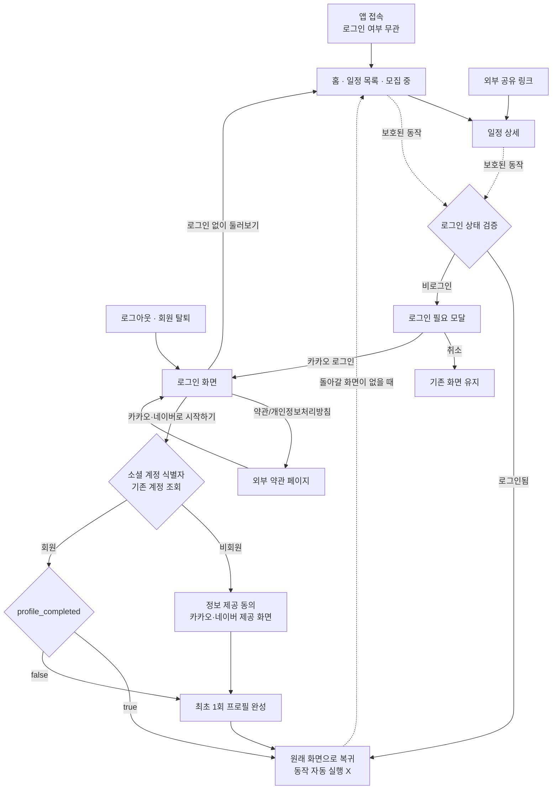
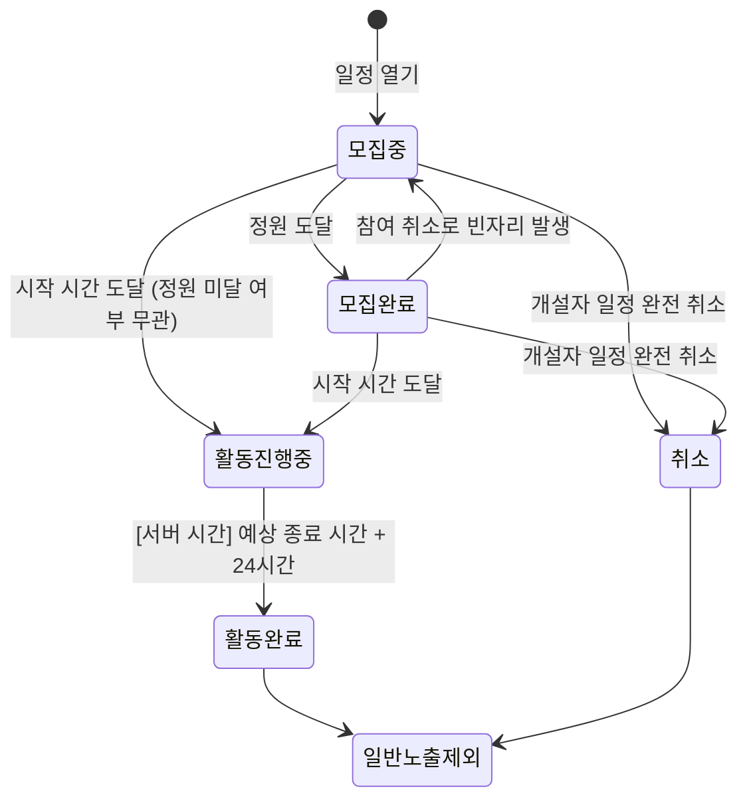

# USER_FLOW.md — 쉬는시간 사용자 흐름

> 이 문서는 **"사용자가 어떻게 서비스를 이용하고 화면 사이를 이동하는가"** 를 다룬다.
> 화면의 시각적 구성(레이아웃, 색상, 컴포넌트)은 [`DESIGN.md`](./DESIGN.md)를 참고한다.

## 0. 문서 기준

- 출처: FigJam 보드 "기획 작업물" (`fileKey: pfVZnQY81EM6AUQt3H6tKs`), 분석 시점 2026-10-03
- 보드에 있는 플로우차트, 분기 다이아몬드, 표, 메모를 **모두** 반영했다. 화면 이미지는 11종만 확인했다(DESIGN.md §0).
- 추가 자료: `loginflow.jpg` ("로그인부터 프로필 완성까지 시나리오" 섹션 export, 이 레포에는 포함되어 있지 않음).
- 화면 시안 원본은 Claude Design으로 만들었다(DESIGN.md §0).
- 초기 와이어프레임 영역과 "MVP 제외, 삭제 요소" 섹션은 기준에서 제외한다.

| 표기 | 의미 |
|---|---|
| ✅ | Figma 플로우·표·화면에서 직접 확인 |
| `추정` | 확인된 내용을 바탕으로 한 추론 |
| `미정의` | Figma에 정의되지 않음. 임의로 결정하지 않는다 |
| ⚠️ | Figma 안에서 서로 충돌하는 내용 |
| 팀 확인 | Figma와 별개로 팀이 확정한 내용. Figma와 다르면 이쪽을 따른다 |

---

## 1. 서비스 개요 ✅

- **목표:** "완성된 커뮤니티 앱"이 아니라 **"일정 하나를 만들고, 다른 사람이 참여하는 흐름 검증"**
- **핵심 흐름:** 사용자 목적에 따라 세 갈래다.
  - **참여:** 일정 보기 → 일정 상세 → `참여하기` → (로그인) → 참여 확정 → 당일 상태 확인 → 일정 관리
  - **개설:** 하단 메뉴 `일정 개설` → (로그인) → 일정 개설 1~5단계 → 당일 상태 확인 → 일정 관리. 일정 목록을 먼저 볼 필요가 없다.
  - **내 일정 확인:** 홈 `참여한 일정` 또는 `개설한 일정` 탭 → (로그인) → 해당 탭 목록 → 일정 상세 → 일정 관리
  - 위의 `(로그인)`은 모두 같은 순서로 진행된다: **로그인 필요 팝업 → `카카오 로그인` → 로그인 화면 → 로그인 완료 → 원래 가려던 화면으로 이동**. 누르려던 동작은 자동으로 실행하지 않는다(§4.3 로그인 후 복귀 규칙). 팝업에서 `취소`를 누르면 기존 화면에 그대로 남는다(§4.2).
  - Figma 원문은 "로그인 → 일정 보기 → 일정 개설·참여 → …" 순서다. 하지만 팀 확인 결과 **일정은 로그인 없이 볼 수 있고**, 로그인은 참여·개설 등 보호된 동작을 하는 시점에 요청된다(§4.2).
- **로그인 정책 (팀 확인):** 일정 목록·상세 조회는 누구나 가능. 참여한·개설한 일정 탭, 참여하기, 일정 개설은 로그인 필요.
- **로그인 수단 (팀 결정, 2026-10-04):** **카카오와 네이버** 두 가지다. Figma 로그인 화면(`247:21229`)에 `카카오로 시작하기`·`네이버로 시작하기` 버튼이 있다. 이 문서에서 "카카오 로그인"으로 적힌 가입·로그인 흐름은 네이버에도 똑같이 적용한다(동의 화면은 네이버가 제공, 프로필 prefill은 네이버 정보). 차이가 생기는 부분은 F-16.
- **MVP 활동 범위:** `머더 미스터리`만 해당한다. `취향대로`(개설자 커스텀 일정)는 MVP 제외, 추후 확장이다.
- **결제:** 앱 안에서 결제하지 않는다. `현장 후불 결제`, `참여자 개인 결제`이고 `예치금x`이다.
- **서비스 형태 (팀 결정, 2026-10-03):** MVP는 **웹뷰 앱**이다. 웹으로 만든 화면을 모바일 앱 안의 웹뷰로 보여준다. 추후 모바일 앱(네이티브) 개발도 고려 중이다.
  - **푸시 알림은 웹뷰 MVP에서도 반드시 동작해야 한다** (팀 결정, 2026-10-03).
  - 플로우에 들어 있는 **푸시 알림, 갤러리 접근 권한, 외부 공유, 카카오 로그인**은 웹뷰 바깥의 앱(네이티브 영역)과 연동이 필요할 수 있다 → F-15.
- **소통:** 채팅이 아니다. 확정 인원 사이의 **댓글형 일정 소통**이며, 당일 집결·위치 공유·일정 문의 용도로 쓴다(친목 용도 자제).

---

## 2. 사용자 상태 정의

| 상태 | 정의 | 근거 |
|---|---|---|
| `Guest` | 로그인하지 않음 (둘러보기) | ✅ |
| `Member · 프로필 미완성` | 카카오 로그인 완료, `profile_completed = false` | ✅ |
| `Member · 프로필 완성` | `profile_completed = true` | ✅ |

일정과의 관계에 따른 역할 ✅:

| 역할 | 정의 |
|---|---|
| 일반 사용자 | 해당 일정과 관계 없음 |
| 확정 참여자 | 참여하기 성공 → 참여 확정 |
| 개설자 | 일정을 연 사용자 |

---

## 3. 전체 사용자 Flow ✅



> **팀 결정 (2026-10-03):** 앱을 열면 로그인 여부와 상관없이 **항상 홈**으로 간다. 로그인 화면은 앱 시작 화면이 아니며, 로그인 필요 모달의 `카카오 로그인`이나 로그아웃·회원 탈퇴 이후에만 나온다.
> Figma에는 `앱 접속 → 로그인 화면` 플로우도 있지만, 팀 결정이 우선한다.

---

## 4. 회원가입 · 로그인 · 로그아웃

### 4.1 회원가입 Flow (= 카카오 최초 로그인) ✅

별도의 회원가입 폼은 없다. **카카오 로그인이 곧 가입 진입점**이다.

1. 로그인 화면에서 `카카오로 시작하기`
2. 카카오 식별자로 기존 계정을 조회한다 → 결과가 **비회원**
3. **정보 제공 동의** (`[필수] 닉네임`, `[필수] 프로필 사진`)
   - ✅ **카카오가 제공하는 동의 화면**이다. 우리 앱에서 구현하지 않는다(팀 확인).
   - `동의하고 계속하기` → 카카오 인증 완료 후 앱으로 돌아옴 → 다음 단계
   - 사용자가 카카오 화면에서 `취소`·`X`로 빠져나왔을 때 앱이 보여줄 화면 → `미정의` (F-3)
4. **최초 1회 프로필 완성** ✅ (화면 확인: `loginflow.jpg`)
   - 화면 안내: "함께할 사람들에게 보여줄 정보를 확인해주세요 / 일정에는 성별과 연령대만 표시돼요."

   | 항목 | 출처 | 규칙 |
   |---|---|---|
   | 프로필 이미지 | 카카오 정보 | 변경 가능 (편집 버튼) |
   | 닉네임 | 카카오 정보 (prefill) | 변경 가능, **중복 체크**. 안내 "카카오 닉네임을 불러왔어요. 바꿀 수 있어요." |
   | 이름 | 직접 입력 | **필수** (팀 결정, 2026-10-04). 실명. **다른 사용자에게 공개하지 않는다** (화면 안내 "다른 사용자에게 공개되지 않아요"). Figma `132:16466` 최신 시안에 추가된 항목 |
   | 성별 | 직접 입력 | 여성 / 남성 중 선택 |
   | 생년월일 | 직접 입력 | 입력 즉시 **연령대 자동 표시** (예: `1996. 04. 12` → `20대 후반`) |
   | ~~이메일~~ | — | **프로필 완성에서는 받지 않는다** (팀 결정, 2026-10-04). 이메일(선택)은 프로필 수정(§8)에서만 입력한다. 검증 규칙·문구는 아래 표를 그대로 쓴다 |

   - 필수 여부: `미정의`. `추정` 성별·생년월일은 동의 화면의 "다음 단계에서 직접 입력해요" 문구로 보아 필수.
   - 화면에 뒤로가기·GNB가 없다 → 이 단계에서 빠져나가는 경로 `미정의` (F-13).

5. `시작하기` → **원래 화면으로 돌아간다** (§4.3 로그인 후 복귀 규칙).

#### 입력값 유효성 검사 (팀 결정: 모든 입력에 필수 적용)

프로필 완성과 프로필 수정에 같은 규칙을 쓴다. 이메일은 프로필 수정에만 있는 항목이다. 검사를 통과하지 못하면 `시작하기`(수정 시 저장)로 진행할 수 없고, 해당 필드에 오류를 표시한다.

| 항목 | 기본 검사 | 세부 기준 |
|---|---|---|
| 닉네임 | 빈 값·공백만 입력 불가, **중복 체크** ✅ | 길이·허용 문자 `미정의` (F-14) |
| 이름 | 빈 값·공백만 입력 불가 (팀 결정, 2026-10-04) | 길이·허용 문자 `미정의` (F-14) |
| 성별 | 하나 선택 필수 `추정` | — |
| 생년월일 | 빈 값 불가, **실제로 존재하는 날짜**, 미래 날짜 불가 | 가입 가능 최소 나이 `미정의` (F-14) |
| 이메일 | 비워 두면 통과. 입력했다면 **이메일 형식** 검사 | — |
| 프로필 이미지 | `추정` 이미지 파일만 허용 | 용량·형식 제한 `미정의` (F-14) |

#### 유효성 검사 문구 (팀 결정, 초안)

말투는 Figma 시안의 안내 문구("카카오 닉네임을 불러왔어요. 바꿀 수 있어요.")에 맞춰 `~해주세요 / ~이에요`로 통일한다. 숫자 기준이 미정인 항목은 `{n}` 자리표시자로 두고 F-14가 정해지면 채운다.

| 항목 | 상황 | 문구 | 종류 |
|---|---|---|---|
| 닉네임 | 비어 있음 / 공백만 입력 | 닉네임을 입력해주세요. | 오류 |
| 닉네임 | 길이 초과·미달 | 닉네임은 {min}~{max}자로 입력해주세요. | 오류 (기준 F-14) |
| 닉네임 | 허용하지 않는 문자 포함 | 닉네임에 사용할 수 없는 문자가 있어요. | 오류 (기준 F-14) |
| 닉네임 | 중복 | 이미 사용 중인 닉네임이에요. 다른 닉네임을 입력해주세요. | 오류 |
| 닉네임 | 중복 확인 통과 | 사용할 수 있는 닉네임이에요. | 성공 |
| 닉네임 | 중복 확인 요청 실패(네트워크 등) | 닉네임을 확인하지 못했어요. 잠시 후 다시 시도해주세요. | 오류 |
| 닉네임 | 카카오 닉네임을 불러온 기본 상태 | 카카오 닉네임을 불러왔어요. 바꿀 수 있어요. | 안내 ✅ (Figma) |
| 이름 | 비어 있음 / 공백만 입력 | 이름을 입력해주세요. | 오류 (2026-10-04 추가) |
| 성별 | 선택하지 않음 | 성별을 선택해주세요. | 오류 |
| 생년월일 | 비어 있음 | 생년월일을 입력해주세요. | 오류 |
| 생년월일 | 자릿수 부족 / 형식 불일치 | 생년월일 8자리를 입력해주세요. (예: 1996. 04. 12) | 오류 |
| 생년월일 | 존재하지 않는 날짜 (예: 2월 30일) | 올바른 날짜를 입력해주세요. | 오류 |
| 생년월일 | 미래 날짜 | 오늘 이후 날짜는 입력할 수 없어요. | 오류 |
| 생년월일 | 최소 나이 미달 | 만 {n}세 이상만 가입할 수 있어요. | 오류 (기준 F-14) |
| 이메일 | 형식 오류 (입력한 경우만) | 올바른 이메일 형식으로 입력해주세요. (예: name@example.com) | 오류 |
| 프로필 이미지 | 이미지가 아닌 파일 | 이미지 파일만 등록할 수 있어요. | 오류 |
| 프로필 이미지 | 용량 초과 | {n}MB 이하의 이미지만 등록할 수 있어요. | 오류 (기준 F-14) |
| 프로필 이미지 | 업로드 실패 | 사진을 올리지 못했어요. 다시 시도해주세요. | 오류 |
| 공통 | 저장(시작하기·수정) 요청 실패 | 저장하지 못했어요. 잠시 후 다시 시도해주세요. | 오류 |

표시 규칙 (팀 결정):
- 오류 문구는 **해당 필드 바로 아래**(Figma 시안의 녹색 안내 문구 자리)에 표시한다. 오류는 오류 색, 안내·성공은 녹색. 오류 색 값은 디자인 미확인(DESIGN D-8).
- 검사 시점: 입력 칸을 벗어날 때(blur) 검사하고, `시작하기`·저장을 누를 때 전체를 다시 검사한다. 오류가 있으면 첫 번째 오류 필드로 이동한다.
- 사용자가 값을 고치면 해당 오류 문구는 바로 사라진다.
- 닉네임 중복 확인은 서버 응답이 필요하다. 확인이 끝나기 전에는 완료할 수 없다.
- 이메일은 선택 입력이라, 비워 둔 상태에서는 어떤 문구도 표시하지 않는다.

### 4.2 로그인 Flow ✅

| 진입 경로 | 결과 |
|---|---|
| 로그인 화면 `카카오로 시작하기` → 기존 회원 + `profile_completed = true` | 원래 화면으로 복귀 (§4.3) |
| 기존 회원 + `profile_completed = false` | 최초 프로필 완성 → 원래 화면으로 복귀 |
| 로그인 필요 모달의 `카카오 로그인` | **서비스 로그인 화면**(`/login`)으로 이동 → 위와 동일. 카카오 인증 화면으로 바로 가지 않는다 |
| 로그인 화면 `네이버로 시작하기` | 카카오와 같은 흐름 (2026-10-04 추가) |

로그인 필요 모달이 뜨는 진입점 ✅ (`loginflow.jpg`에서 화면과 함께 확인):

| # | 비로그인 사용자의 동작 | 근거 |
|---|---|---|
| 1 | 홈(일정 목록)에서 `참여한 일정` 탭 클릭 — 탭이 바뀐 뒤 모달이 뜬다. 취소하면 그 탭 화면에 남는다 (2026-10-05) | ✅ Figma + 팀 확인 |
| 2 | 홈(일정 목록)에서 `개설한 일정` 탭 클릭 | ✅ Figma + 팀 확인 |
| 3 | 일정 상세에서 `참여하기` 클릭 | ✅ Figma + 팀 확인 |
| 4 | 하단 메뉴(GNB)에서 `일정 개설` 클릭 | ✅ Figma + 팀 확인 |
| 5 | 하단 메뉴(GNB)에서 `내 정보` 클릭 | ✅ Figma |
| 6 | 일정 상세에서 `제보` 클릭 | ✅ Figma |

- ✅ **팀 확인 (2026-10-03):** 일정은 로그인하지 않아도 볼 수 있다. 1~4번 동작에서 로그인 요청 팝업이 뜨고, 로그인해야 이용할 수 있다.

- ✅ 로그인 화면에서 `로그인 없이 둘러보기`를 누르면 **홈으로 가서 비로그인 사용자로 계속 이용**한다.
- ✅ 약관·개인정보처리방침을 보고 나면 **로그인 화면으로 복귀**한다.
- ⚠️ 이 시나리오 이미지에서는 `회원 → 원래 요청한 기능`으로 바로 이어진다. 다른 플로우에는 `회원 → profile_completed 확인` 분기가 있다. 두 플로우를 합치면 위 표와 같다.


#### 카카오 로그인 구현 (2026-10-04)

기존 프로젝트(Vite)의 백엔드 연동 방식을 그대로 따른다.

| 단계 | 내용 |
|---|---|
| 1. 카카오 인증 이동 | 로그인 화면 `카카오 로그인` → `https://kauth.kakao.com/oauth/authorize` (`response_type=code`, `client_id`, `redirect_uri`, `state`). SDK 없이 주소 이동. 동의항목은 콘솔 설정을 따른다(`scope` 없음) |
| 2. 돌아올 화면 | `redirect` 값을 OAuth `state`에 담아 보내고 콜백에서 다시 꺼낸다. 사이트 안 경로(`/`로 시작)만 허용 |
| 3. 콜백 | `/auth/kakao/callback` (= 카카오 콘솔 로그인 Redirect URI `http://localhost:5173/auth/kakao/callback`). `code`를 꺼내 백엔드에 넘긴다. 인가 코드는 한 번만 쓸 수 있어 요청은 한 번만 보낸다 |
| 4. 백엔드 API | `POST /api/auth/kakao/callback` `{ code }` → `{ authStatus, accessToken?, refreshToken?, user?, signupToken?, requiredFields?, socialUser? }` (기존 프로젝트 `authSession.js` 기준). 백엔드 준비 전에는 MSW가 대신 응답한다 |
| 5. 분기·저장 | `accessToken`이 있으면 **기존 회원**: localStorage `token`·`refreshToken`·`user` 저장 → 원래 화면(`redirect`). `authStatus = ADDITIONAL_INFO_REQUIRED` + `signupToken`이면 **신규 회원**: sessionStorage `signupToken`·`requiredFields`·`socialUser` 저장 → 프로필 완성(`/signup`) |
| 6. 가입 완료 | 프로필 완성 화면이 `socialUser`의 닉네임·사진을 미리 채운다. `시작하기` → `POST /api/auth/signup` `{ signupToken, name, nickname, email, gender(MALE·FEMALE), birthDate(YYYY-MM-DD) }` → `SIGNUP_SUCCESS` + 토큰 → 5의 기존 회원과 같이 저장 → 토스트 "로그인이 완료되었습니다."(임시 문구) → 원래 화면. 이름·닉네임·이메일·성별은 필수, 이메일은 화면에서 받지 않고 `socialUser.email`을 보낸다. 엔드포인트는 임시(MSW) |
| 7. 실패 | `code` 없음(카카오 취소·오류) 또는 API 실패 → `alert("로그인에 실패했습니다.")` 후 로그인 화면(`/login`). 실패 화면 디자인은 F-3 |

- 가입 진행 정보 없이 `/signup`에 들어오면 로그인 화면으로 보낸다. `로그인 없이 둘러보기`는 sessionStorage `guest = true`를 남긴다(로그인하면 지움).
- API 요청에는 localStorage `token`을 `Authorization: Bearer`로 붙인다(기존 프로젝트 방식).
- Client Secret은 백엔드에서만 쓴다. 프론트엔드는 REST API 키와 Redirect URI만 환경변수(`NEXT_PUBLIC_KAKAO_*`)로 받는다.
- 개발 서버는 Redirect URI에 맞춰 **5173 포트**로 실행한다(`pnpm dev`). 백엔드도 토큰 교환 시 같은 redirect_uri를 써야 한다.

### 4.3 로그인 후 복귀 규칙 (팀 확인, 2026-10-03)

Figma의 "원래 요청한 기능·절차 진행"은 **화면 복귀만 한다**는 뜻으로 확정한다. 누르려던 동작은 자동으로 실행하지 않는다.

| 로그인을 요청한 동작 | 유형 | 로그인 완료 후 |
|---|---|---|
| 홈 `참여한 일정` / `개설한 일정` 탭 | 화면 이동 | 해당 탭이 선택된 일정 목록으로 이동 (`redirect=/?tab=joined` 처럼 탭을 URL로 넘긴다) |
| 하단 메뉴 `일정 개설` | 화면 이동 | 일정 개설 1단계로 이동 |
| 하단 메뉴 `내 정보` | 화면 이동 | 내 정보 화면으로 이동 |
| 일정 상세 `참여하기` | 실행 | **같은 일정 상세로 복귀**. 참여는 사용자가 다시 눌러야 한다 |
| 일정 상세 `제보` 등 그 밖의 실행형 동작 | 실행 | 같은 화면으로 복귀. 자동 실행하지 않음 |

- 신규 사용자(동의 → 프로필 완성)도 같은 규칙을 따른다. 프로필 완성 후 위 표의 화면으로 이동한다.
- 이유: 로그인·가입 중에 정원·상태가 바뀔 수 있고, 참여는 되돌리기 어렵다(진행 중 취소 불가, 중복 참여 제한). 사용자가 최신 정보를 보고 직접 다시 누르게 한다.
- `추정` 구현 시 로그인 직전에 **돌아갈 화면 주소만** 기억하면 된다. 어떤 동작을 하려 했는지는 저장하지 않는다.
- 로그인 실패(카카오 오류, 사용자 취소) 처리는 `미정의` → Open Questions F-3.

### 4.4 로그아웃 Flow ✅

```
내 정보 → 로그아웃
  → [검사] 모집중·모집완료·활동 진행중 상태인, 내가 참여하거나 개설한 일정이 있는가?
      ├─ 있음 → 팝업 "소식을 전달받지 못할 우려가 있습니다. 진행중인 일정이 마무리 되기 전까지는 로그아웃하실 수 없습니다." (로그아웃 차단)
      └─ 없음 → 현재 세션 즉시 종료 → 로그인 화면
```

### 4.5 회원 탈퇴 Flow ✅

```
내 정보 → 회원 탈퇴
  → [검사] 로그아웃과 같은 조건 (진행 중 일정 존재 여부)
      ├─ 있음 → 팝업 "진행중인 일정이 있습니다. 모든 일정 취소 혹은 진행 중 이후 24시간이 지나야 회원 탈퇴가 가능합니다."
      └─ 없음 → 확인 팝업 "흑흑 슬프네요. 정말 탈퇴하실 건가요?"
                 ├─ 취소 → 계정 유지
                 └─ 확인 → 탈퇴 완료 → 계정·개인정보 즉시 파기(법정 보존 정보 분리 보관)
                           → 세션 종료 → 로그인 화면
```

- ✅ 탈퇴한 카카오 계정으로 다시 로그인하면 **신규 계정이 생성**되고, 최초 프로필부터 다시 시작한다. 이전 기록과 연동되지 않는다.

---

## 5. 홈 화면 진입 Flow

> ✅ **홈 = GNB 첫 탭 `일정`의 일정 목록**이다(팀 확인: "홈 화면 참여한 일정, 개설한 일정 탭"). Figma 최신안에는 "홈"이라는 이름의 화면이 따로 없다.

| 경로 | 결과 | 근거 |
|---|---|---|
| **앱 접속 (로그인·비로그인 모두)** | **홈 (일정 목록 · 모집 중 탭)** | 팀 결정 |
| 로그인 화면 → `로그인 없이 둘러보기` | 홈 (일정 목록 · 모집 중) | ✅ |
| 로그인·가입 완료 | 원래 화면으로 복귀 (§4.3). 돌아갈 화면이 없으면 **홈** | 팀 결정 |
| GNB `일정` | 일정 목록 | ✅ |

---

## 6. 로그인 상태에 따른 차이 ✅

| 기능 | Guest | Member |
|---|---|---|
| 일정 목록 · 모집 중 탭, 필터 | 가능 (팀 확인) | 가능 |
| 일정 목록 · 참여한 일정 / 개설한 일정 탭 | 탭이 바뀌고 **로그인 필요 모달** (팀 확인) | 가능 (목록 API·빈 화면 디자인은 미정, D-6) |
| 일정 상세 조회 | 가능 (목록·외부 링크에서 진입, 팀 확인) | 가능 |
| 공유하기 | 가능 (로그인 검증과 연결되어 있지 않음) | 가능 |
| 참여하기 | **로그인 필요 모달** (팀 확인) | 조건부 가능 (§7.4) |
| 참여 취소 / 일정 전체 취소 | 로그인 필요 모달 (Figma) | 조건부 가능 (§7) |
| 제보하기 (일정 / 참여자) | 로그인 필요 모달 (Figma) | 조건부 가능 |
| 일정 소통(댓글) | 로그인 필요 모달 (Figma) | 개설자·확정 참여자만 |
| GNB 일정 개설 | **로그인 필요 모달** (팀 확인) | 가능 |
| GNB 내 정보 | 로그인 필요 모달 (Figma) | 가능 |

- `미정의` Guest가 상세에서 참여자 명단을 볼 수 있는지 → F-6.
- ✅ 프로필 완성 화면 문구 "일정에는 성별과 연령대만 표시돼요." → 생년월일 원본은 다른 사용자에게 노출하지 않는다.

---

## 7. 일정 관련 Flow

### 7.1 일정 상태 전이 ✅



### 7.2 상태·역할별 버튼 ✅ (Figma 표 원문)

| 일정 상태 | 참여자에게 보이는 버튼 | 개설자에게 보이는 버튼 |
|---|---|---|
| 모집 중 | 참여하기 · 공유하기 · 제보하기 | 수정 · 공유하기 · 전체 취소 |
| 모집 완료 | 공유하기 · 제보하기 | 수정 · 공유하기 · 전체 취소 |
| 활동 진행 중 | 일정 소통 · 참여 취소 · 제보하기 | 일정 소통 · 참여자 확인 · 전체 취소 |
| 활동 완료 | 제보하기 | 제보 확인 · 일정 확인 |
| 취소 | 취소 사유 확인 | 취소 사유 확인 |

> ⚠️ 이 표는 다른 플로우들과 여러 곳에서 충돌한다 → Open Questions F-4, F-5.

### 7.3 일정 탐색

```
일정 목록 → [탭] 모집 중 · 참여한 일정 · 개설한 일정
         → [필터] 활동 / 지역 / 날짜 → 일정 정보 재정렬
         → 카드 선택 → 일정 상세 → (뒤로가기) 목록
```

| 필터 | 옵션 (✅ Figma 표) |
|---|---|
| 활동 | 머더 미스터리 (확장성 고려) — ⚠️ 바텀시트 화면에는 `보드게임 / 취향대로` |
| 지역 | 전체 / 마포구 / 서대문구 / 성동구 |
| 날짜 | 선택 안함(기본) / 이번 주 일~토요일 |

- ✅ 기획 표에는 `시간대`(5구간)와 `정렬`(최신순 기본 / 남은 자리 임박 / 시간 마감 임박)도 있다. 하지만 목록 화면의 칩은 3개뿐이고, `정렬`은 "MVP 제외" 섹션에 들어가 있다 → F-7.
- ✅ '모집 중' 탭 = 모집중 + 모집완료 일정 (`모집중 (+모집완료)`).
- ✅ 참여한 일정이 없으면 `모집 중인 일정 보기` 버튼 → 모집 중 탭으로 이동한다.
- ✅ 개설한 일정이 없으면 `일정 개설하기` 버튼 → 일정 개설 시나리오로 이동한다.

### 7.4 참여하기 ✅

```
상세 → 참여하기 → [로그인 검증]
  → [검사 1: 일정 중복] 모집중·모집완료·활동 진행중 상태인, 내가 참여·개설한 일정과 중복되지 않는가
  → [검사 2: 정원 여유] 모집 인원이 남아 있는가
      ├─ 아니요 → 팝업 "이미 참여중인 다른 일정이 있습니다"
      └─ 예 → 참여 확정 (푸시 없음)
              → 정원 도달? 예: 상태 = 모집 완료 / 아니요: 모집 중 유지
              → 활동 당일 06:00 이후 신청? 예: 즉시 '참여 안내' 푸시 1회
              → [참여 확정 처리] 소통 기능 사용 가능 · 참여하기 버튼 숨김 · 참여 취소 버튼 노출
```

- `미정의` "중복"의 기준(시간이 겹치는 경우만인지, 진행 중 일정이 하나라도 있으면 막는지) → F-8.
- `미정의` 정원이 꽉 차서 실패했을 때의 안내(현재 팝업 문구는 중복 케이스뿐) → F-8.

### 7.5 참여 취소 ✅ (내가 참여한 일정)

```
참여 취소 → [일정 상태]
  ├─ 활동 완료·취소 → 조회 불가 (상세 정보 자체 조회 불가)
  ├─ 활동 진행 중  → 팝업 "이미 진행중인 일정은 취소하실 수 없습니다."
  └─ 모집중·모집완료 → 취소 확인 팝업
        ├─ 닫기 → 화면 유지
        └─ 확인 → 안내 "일정이 정상 취소되었습니다." → 내 참여 상태 = 취소, 참여자 수 감소
                 → 이전 상태가 모집완료였다면 서버에서 '모집중'으로 전환
                 → 다른 사용자 참여 가능 (푸시 없음)
```

### 7.6 일정 전체 취소 ✅ (내가 개설한 일정)

```
일정 전체 취소 → [일정 상태]
  ├─ 활동 완료·취소 → 조회 불가
  ├─ 활동 진행 중  → 팝업 "이미 진행중인 일정은 취소하실 수 없습니다."
  └─ 모집중·모집완료 → 취소 확인 팝업
        ├─ 닫기 → 화면 유지
        └─ 확인 → 취소 사유 입력 → 취소 내용 재확인(미리보기) ⇄ 수정
                 → 상태 = 취소 → '취소 안내' 푸시 (개설자·확정 참여자) → 전체 취소 완료
```

### 7.7 일정 개설 ✅

진입 조건: 로그인 필요 (팀 확인).

| 단계 | 내용 | 규칙 |
|---|---|---|
| 1. 활동 선택 | 활동 종류 | 머더 미스터리 (추후 확장) |
| 2. 장소·세부 선택 | 지역(전체/마포구/서대문구/성동구) → 장소 목록 → 장소 정보 확인 | 장소 정보(장소명·주소·후불 결제 여부·예상 비용·네이버 지도)는 DB에서 가져옴 |
| 2-1. 콘텐츠 | **둘 중 하나**: DB 콘텐츠(머더 미스터리 시나리오) / **활동 직접 준비** | 각각 대표 사진(보류)·예상 소요시간·간략 설명 |
| 3. 날짜·시작 시간 | 날짜, 시작 시간 선택 | **예상 종료 시간 = 시작 시간 + 콘텐츠 소요시간** (자동 계산) |
| 4. 모집 인원 | 권장 인원 자동 설정 / 인원 수 직접 설정 | 범위 `미정의` (초기 와이어프레임에 2~6명 칩) |
| 5. 최종 확인 | 미리보기 → `일정 열기` 또는 `수정하기`(입력폼으로 복귀) | `일정 열기` → **모집중으로 전환, 이후 일정 수정 불가** |

- ✅ 미리보기 예시: `머더 미스터리 · 홍대 보드게임 카페 / 10월 3일 토요일 19:00 / 예상 소요 시간 약 2시간 / 2~6명 · 현장 후불 결제`

### 7.8 일정 소통(댓글) ✅

```
일정 소통 → [로그인 검증] → [일정 상태]
  ├─ 활동 완료·취소 → 조회 불가
  └─ 모집중·모집완료·활동 진행중 → [해당 일정의 개설자 또는 확정 참여자인가]
        ├─ 아니요 → 클릭 비활성 + "참여가 확정된 경우에만 사용하실 수 있습니다"
        └─ 예 → 자유 입력 댓글 작성 → 일정 댓글 스레드에 표시
               → '소통 알림' 푸시 (참여자 → 개설자 또는 개설자 → 참여자)
               → 상대방 답변 → 답변 대상에게 푸시
```

- ✅ 개설자는 **먼저 댓글을 쓸 수 없다**(선톡 기능 제거). 확정 참여자가 댓글을 쓰면 답변만 가능하다.

### 7.9 제보하기 ✅

```
제보하기(일정 상세 헤더 또는 참여자 명단) → [로그인 검증] → [일정 상태]
  ├─ 활동 완료·취소 → 조회 불가
  └─ 모집중·모집완료·활동 진행중 → 특정 일정·사용자 제보
        → 유형 선택: 일정 불일치 / 불편한 언행 / 연락처 요구 / 성적 접근 / 노쇼 / 기타
        → [서버 저장] 제보자·대상자·일정 ID·유형·시각
        → 팝업 "제보가 접수되었습니다." (별도 푸시 없음)
```

- ✅ 운영자는 제보 로그 조회만 가능하다(운영자 기능은 사용자 앱 범위 밖).

### 7.10 공유하기 ✅

- 상세 → 공유하기 → 외부 네트워크 공유
- 공유 단위(마케팅 가치 단위): 활동명(준비된 멘트) · 대표 이미지 · 장소명 · 활동 장소 · 시작 날짜·시간 · 예상 소요 시간 · 모집 인원 · **참여 링크**
- 외부 링크로 방문하면 → **일정 상세**로 진입한다.

---

## 8. 내 정보 Flow ✅

| 메뉴 | Flow |
|---|---|
| 프로필 | 이미지·닉네임·성별·생년월일·이메일(선택) → 항목별 수정(닉네임 중복 체크, 이메일 형식 검사) → "수정완료되었습니다" |
| 프로필 사진 변경 | 갤러리 권한이 없으면 → 권한 허용 요청 팝업 |
| 알림함 | 알림 이력 0개 → "전송된 메세지가 없습니다…14일 이후 자동 삭제됩니다" / 1개 이상 → 최근순 목록 |
| 로그아웃 | §4.4 |
| 회원 탈퇴 | §4.5 |

- 📝 `알림 설정` 메뉴는 초기 와이어프레임에만 있고 최신 플로우에는 없다 → 기준에서 제외한다.

---

## 9. 알림(푸시) 규칙 ✅

> **팀 결정 (2026-10-03): 푸시 알림은 MVP 필수 기능이다.** 웹뷰 앱에서도 아래 4종 알림이 기기 푸시로 와야 한다.
> `추정` 웹뷰 안의 웹 화면만으로는 기기 푸시를 받을 수 없다(브라우저 웹 푸시는 앱 웹뷰에서 동작하지 않음). 따라서 **웹뷰를 감싸는 앱이 푸시 수신·권한 요청을 맡고, 웹은 로그인 사용자 정보를 앱에 전달**하는 구조가 필요하다. 구체적인 분담은 F-15.

| 카테고리 | 의미 | 대상 | 발신자 |
|---|---|---|---|
| 소통 알림 | 일정 소통 댓글 소식 | 해당 일정의 관련 사용자 | 개설자 / 일정 참여자 |
| 일정 안내 | 활동 당일 06:00, 1회 | 개설자·확정 참여자 | 운영자 |
| 참여 안내 | 활동 당일 06:00 이후 참여 확정 즉시, 1회 | 해당 참여자 | 운영자 |
| 취소 안내 | 일정 전체 취소 완료 시 | 개설자·확정 참여자 | 개설자 |

- 알림함 목록 항목: 카테고리 · 발신자 · 내용. 최근순 정렬.
- 수신 후 **14일이 지나면 열람 여부와 상관없이 자동 삭제**된다.
- 참여 확정, 참여 취소, 제보 접수에는 **푸시가 없다.**

---

## 10. 성공 / 실패 / 예외 Flow 요약

| 구분 | 상황 | 결과 |
|---|---|---|
| 성공 | 가입·로그인 완료 | 원래 화면으로 복귀, 동작 자동 실행 X (팀 확인) |
| 성공 | 참여 확정 | 버튼 전환, 소통 활성 ✅ (사용자에게 보여줄 피드백은 `미정의`) |
| 성공 | 참여 취소 | "일정이 정상 취소되었습니다." ✅ |
| 성공 | 일정 개설 | 일정 개설 완료 화면 ✅ (화면 미확인) |
| 성공 | 전체 취소 | 전체 취소 완료 화면 ✅ |
| 성공 | 제보 / 프로필 수정 | "제보가 접수되었습니다." / "수정완료되었습니다" ✅ |
| 실패 | 참여 시 일정 중복 | "이미 참여중인 다른 일정이 있습니다" ✅ |
| 실패 | 진행 중 일정 취소 시도 | "이미 진행중인 일정은 취소하실 수 없습니다." ✅ |
| 실패 | 닉네임 중복 | "이미 사용 중인 닉네임이에요. 다른 닉네임을 입력해주세요." (§4.1 유효성 검사 문구) |
| 실패 | 프로필 입력값 오류 (닉네임·이름·성별·생년월일·이미지, 수정 화면은 이메일 포함) | 완료 불가, 해당 필드 아래 오류 문구 표시 (§4.1 유효성 검사 문구) |
| 실패 | 카카오 로그인 실패·취소 | `미정의` |
| 예외 | 비로그인 상태에서 보호된 동작 | 로그인 필요 모달 ✅ |
| 예외 | 완료·취소된 일정 접근 | 조회 불가 ✅ (보여줄 화면 `미정의`) |
| 예외 | 진행 중 일정이 있을 때 로그아웃·탈퇴 | 차단 팝업 ✅ |
| 예외 | 확정되지 않은 사용자의 댓글 시도 | 클릭 비활성 + 안내 문구 ✅ |
| 예외 | 갤러리 권한 없음 | 권한 요청 팝업 ✅ |
| 예외 | 네트워크·서버 오류 | `미정의` |

---

## 11. 필요한 데이터 / API (`추정`)

> 아래는 Figma 화면과 플로우에 **필요한 데이터 묶음**이다. 엔드포인트, 요청·응답 형식, 인증 방식은 결정하지 않는다(백엔드와 협의 대상).

| 데이터 | 사용 화면 | 비고 |
|---|---|---|
| 인증 세션 / 현재 사용자 (`profile_completed` 포함) | 전역 | 카카오 로그인 결과 |
| 사용자 프로필 (이미지·닉네임·이름(비공개)·성별·생년월일·이메일(선택, 수정 화면만)) | 프로필 완성·수정 | 카카오 닉네임·이미지 prefill 값 필요. 닉네임 중복 확인이 별도로 필요 |
| 진행 중 일정 존재 여부 | 로그아웃·탈퇴·참여 | 서버 판정으로 보임 ("로그인 상태 서버 섹션 검증") |
| 일정 목록 (탭·필터 조건별) | 홈 | 카드 항목: 날짜(요일)·시작 시간·콘텐츠 제목·장소·잔여/모집 인원·예상 비용·결제 방식·상태·대표 사진(보류) |
| 필터 옵션 (활동·지역·날짜) | 홈, 개설 2단계 | 고정값인지 서버 데이터인지 → F-9 |
| 일정 상세 | 상세 | 모집 상태·활동 종류·콘텐츠 제목·장소명·간략 설명·시작 시간·예상 소요·예상 비용·모집 인원·참여자 명단·장소 지도·주소 + **내 역할(개설자/확정 참여자/무관)** |
| 참여자 명단 | 상세 | 프로필 이미지·닉네임·성별·연령대 |
| 장소 목록 / 장소 정보 | 개설 2단계 | 장소명·주소·후불 결제 여부·예상 비용(입장료) |
| 콘텐츠(시나리오) 목록 | 개설 2단계 | 대표 사진(보류)·소요시간·간략 설명·권장 인원 `추정` |
| 일정 생성 / 참여 / 참여 취소 / 전체 취소(사유) | 각 액션 | 성공·실패 사유 코드가 필요함 `추정` |
| 댓글 스레드 / 댓글 작성 | 일정 소통 | |
| 제보 생성 | 제보 | 대상 일정 또는 사용자, 유형 |
| 알림 목록 | 알림함 | 카테고리·발신자·내용·수신 시각 |
| 공유용 일정 요약 + 참여 링크 | 공유 | 외부 링크로 들어오면 상세 진입 |
| 지도 | 상세, 개설 2단계 | **네이버 지도 외부 API, 2D 지도 View** ✅ |

- `추정` 일정 상태는 시간에 따라 바뀐다(시작 시간, 종료 + 24시간). 그래서 **서버가 내려준 상태를 그대로 표시**하고 클라이언트가 계산하지 않는 편이 기획과 맞다.

---

## 12. Figma에서 확인되는 비즈니스 규칙 ✅ (요약)

1. 시작 시간이 되면 정원 미달이어도 `활동 진행 중`이 된다.
2. 예상 종료 시간 + 24시간(서버 시간)이 지나면 `활동 완료`가 된다.
3. 완료·취소된 일정은 일반 목록에서 빠지고, 상세 조회가 불가하다.
4. 모집완료 일정에서 참여 취소로 빈자리가 생기면 `모집중`으로 돌아간다.
5. 일정을 연 뒤에는 **수정할 수 없다**(⚠️ 버튼 표와 충돌).
6. 진행 중(모집중·모집완료·활동 진행중) 일정이 있으면 새 참여, 로그아웃, 탈퇴가 제한된다.
7. 활동 진행 중에는 참여 취소와 전체 취소가 불가하다.
8. 댓글은 개설자와 확정 참여자만 쓸 수 있고, 개설자는 먼저 시작할 수 없다.
9. 알림은 14일 후 자동 삭제된다.
10. 탈퇴하면 개인정보를 즉시 파기하고, 같은 카카오 계정으로 재가입하면 신규 계정이 된다.
11. 예상 종료 시간은 시작 시간과 콘텐츠 소요시간으로 자동 계산된다.
12. 다른 사용자에게는 생년월일 대신 **연령대**(예: `20대 후반`)만 보인다.

---

## 13. 구현 순서 참고 (`추정`)

화면 사이의 의존 관계를 기준으로 정리했다. 기술 선택과는 무관하다.

1. **인증 상태 + 로그인 화면 + 로그인 필요 모달:** 모든 보호된 동작의 전제다.
2. **가입(프로필 완성) + 로그인 후 복귀:** 카카오 동의 화면은 구현하지 않는다. 프로필 완성 화면 하나만 구현한다.
3. **홈(일정 목록, 모집 중 탭 + 필터):** Guest도 쓸 수 있는 첫 화면이다.
4. 일정 상세 → 참여 / 취소 → 참여한·개설한 일정 탭
5. 일정 개설 → 일정 소통 / 제보 / 공유 → 내 정보 / 알림함

---

## 14. Open Questions (Flow)

| ID | 질문 | 영향 |
|---|---|---|
| F-3 | 카카오 로그인 실패, 또는 사용자가 카카오 동의 화면에서 `취소`·`X`로 빠져나와 앱으로 돌아왔을 때 어디로 가고 무엇을 보여주는가? | 로그인 콜백 에러 처리 |
| F-4 | 일정을 연 뒤 수정할 수 있는가? (플로우: 불가 / 버튼 표: 개설자 `수정` 버튼 있음 / 역할표: `일정 수정` 담당자 있음) | 개설자 상세 버튼, 수정 화면 유무 |
| F-5 | 버튼 표와 플로우 충돌: ① 활동 완료·취소 일정을 볼 수 있는가(플로우: 조회 불가 / 표: 제보·취소 사유 확인)? ② 활동 진행 중 참여 취소가 가능한가? ③ 모집완료 상태의 확정 참여자에게 참여 취소 버튼이 보이는가? | 상세 화면 버튼 노출 로직, 참여한 일정 목록 |
| F-6 | Guest에게 일정 상세의 참여자 명단(닉네임·성별·연령대)을 보여주는가? | 상세 화면 권한별 노출 |
| F-7 | MVP 필터 범위는? 활동 값은 `머더 미스터리`인가 `보드게임/취향대로`인가? 시간대 필터와 정렬은 포함하는가? | 홈 필터 UI, 목록 조회 조건 |
| F-8 | 참여 시 "일정 중복"의 기준(시간 겹침인지, 진행 중 일정 1개 제한인지)과 정원 초과 시 안내는? | 참여하기 실패 처리, 안내 문구 |
| F-9 | 필터 옵션(활동·지역)과 장소·콘텐츠 목록은 서버에서 받아오는가, 앱에 고정하는가? | 홈 필터, 개설 2단계 데이터 구조 |
| F-12 | 연령대 산출 기준은? (`20대 후반`처럼 초반·중반·후반으로 나누는 경계, 만 나이 기준 여부) 클라이언트에서 계산하는가, 서버가 내려주는가? | 프로필 완성 화면 표시, 참여자 명단 |
| F-13 | 프로필 완성 단계에서 사용자가 이탈(뒤로가기·앱 종료)하면 어떻게 되는가? 다시 로그인 시 프로필 완성으로 재진입하는가? | 가입 플로우 라우팅, 미완성 계정 처리 |
| F-16 | 네이버 로그인의 세부 흐름: 네이버 동의 항목(닉네임·프로필 사진 제공 여부), 프로필 완성 prefill 문구("카카오 닉네임을 불러왔어요"의 네이버 버전), 같은 사람이 카카오·네이버로 각각 가입하면 다른 계정인가? 로그인 필요 모달 문구 "카카오 로그인 후 이용해주세요"와 버튼 `카카오 로그인`을 그대로 쓰는가? | 프로필 완성 화면, 계정 정책, 로그인 필요 모달 문구 |
| F-15 | 웹뷰를 감싸는 앱(네이티브 영역)은 누가 만드는가? **푸시 알림은 MVP 필수(팀 결정)이므로 앱 쪽 작업이 반드시 필요하다.** 푸시 수신·권한 요청·기기 토큰 등록, 알림을 눌렀을 때 해당 화면으로 이동, 갤러리 권한(Android WebView는 앱이 파일 선택 `onShowFileChooser`를 구현해야 웹의 사진 선택이 열린다), 외부 공유, 카카오 로그인을 앱과 웹 중 어디서 처리하고 둘 사이를 어떻게 연결(브리지)하는가? | 푸시·프로필 사진·공유·로그인 구현 방식 전반, 일정 |
| F-14 | 입력값 세부 기준은? 닉네임·이름 길이·허용 문자, 가입 가능 최소 나이, 프로필 이미지 용량·형식 제한 | 프로필 완성·수정 유효성 검사, 백엔드 검증과 일치 |
