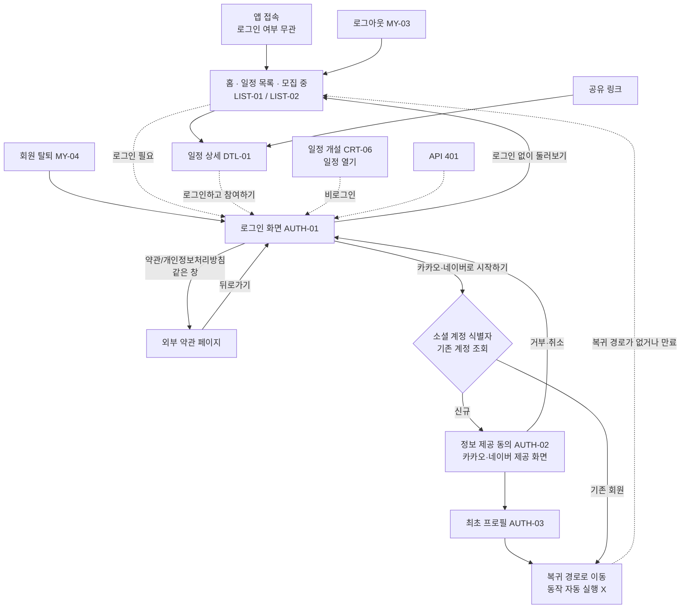
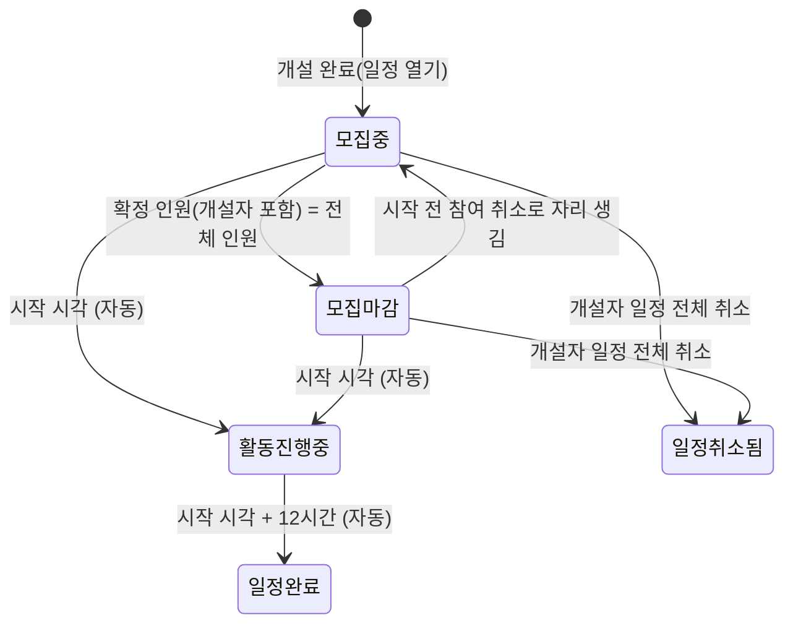

# USER_FLOW.md — 쉬는시간 사용자 흐름

> 이 문서는 **"사용자가 어떻게 서비스를 이용하고 화면 사이를 이동하는가"** 를 다룬다.
> 화면의 시각적 구성(레이아웃, 색상, 컴포넌트)은 [`DESIGN.md`](./DESIGN.md)를 참고한다.

## 0. 문서 기준

- 기준 문서 (2026-10-28 반영):
  - **기능 요구사항 정의서 v0.3** (2026-10-18): 기능별 정의·정책·입력 규칙
  - **화면 기능 명세서 MVP** (2026-10-24, 정의서 v0.3 기준): 화면 30개의 입력·출력·전송·예외. 부록의 디자인 UI(`MVP 핵심 화면` 파일)가 시각 기준이다
- 두 문서는 레포에 커밋하지 않는다. 이전 기준이던 FigJam 보드 "기획 작업물"(`fileKey: pfVZnQY81EM6AUQt3H6tKs`, 2026-10-03 분석)의 일정·알림 흐름은 위 두 문서로 바꿨다. 예전 내용은 git 이력에서 본다.
- 화면 ID는 화면 기능 명세서의 ID(`AUTH-03`, `LIST-02`, `DTL-05-1` 등)를 쓴다. Linear 이슈 제목 앞에도 같은 ID를 붙인다.
- **범위:** 화면 기능 명세서의 "MVP 핵심 화면"만 다룬다(팀 결정, 2026-10-28). 로그인, 일정 목록, 일정 개설, 일정 참여, 공유하기, 참여자 명단, 내 정보, 접속 환경(부록 ENV)이다.
  - **범위 밖:** 일정 소통, 푸시 알림·알림함·알림 설정, 홈 화면 추가 안내(ONB), 제보, 별점·리뷰. 정의서 v0.3에는 정책이 있지만 이 문서에는 옮기지 않는다. 구현하지 않는다.

| 표기 | 의미 |
|---|---|
| ✅ | 정의서 v0.3 또는 화면 기능 명세서에서 확인 |
| `추정` | 확인된 내용을 바탕으로 한 추론 |
| `미정` | 기획 문서에 "미정"·"확인 필요"로 되어 있거나 정의되지 않음. 임의로 결정하지 않는다 |
| ⚠️ | 문서끼리 다르거나, 문서와 지금 코드가 다름 |
| 팀 결정 / 팀 확인 | 기획 문서와 별개로 팀이 정한 내용. 기획 문서와 다르면 이쪽을 따른다 |

---

## 1. 서비스 개요 ✅

- **목표:** "완성된 커뮤니티 앱"이 아니라 **"일정 하나를 만들고, 다른 사람이 참여하는 흐름 검증"**
- **핵심 흐름:**
  - **참여:** 일정 목록 → 일정 상세 → `참여하기` → 참여 확정. 비로그인이면 `로그인하고 참여하기` → 로그인 → 같은 상세로 돌아와 다시 누른다.
  - **개설:** GNB `일정 개설` → 1~6단계 입력 → `일정 열기` → 개설 완료. 비로그인도 입력은 할 수 있고, `일정 열기`에서 로그인한다.
  - **내 일정 확인:** 홈의 `참여한 일정`·`개설한 일정` 탭.
- **로그인 정책:** 일정 목록·상세 조회, 공유 링크 열람, 일정 개설 입력은 누구나 할 수 있다. 참여, 개설 완료(`일정 열기`), 참여한·개설한 일정, 내 정보는 로그인해야 한다.
- **로그인 수단:** 카카오와 네이버 (팀 결정 2026-10-04, 2026-10-28 다시 확인). 이 문서에서 "카카오 로그인"으로 적은 흐름은 네이버에도 똑같이 적용한다. 차이가 생기는 부분은 F-16.
  - ⚠️ 정의서 v0.3과 화면 기능 명세서는 MVP를 카카오만으로, 그 밖의 소셜 로그인을 확장으로 둔다. 시안의 로그인 화면에도 카카오 버튼만 있다.
- **MVP 활동:** `보드게임` 1개 (정의서 v0.3, 팀 확인 2026-10-28). 활동 목록은 서버에서 받는다(사용 중인 항목만).
  - ⚠️ 화면 기능 명세서(LIST-03, CRT-01)는 `보드게임 / 방탈출 / 산책` 3개다. 정의서를 따른다.
- **결제·비용:** 앱 안에서 결제하지 않는다. 비용 정보는 저장하지 않고, 비용·준비물은 개설자가 간략 설명에 적는다. 결제 방식·영업시간은 서비스가 보장하지 않고 개설자가 직접 확인한다.
- **서비스 형태 (팀 확인, 2026-10-28):** **웹앱**이다. 브라우저로 접속하거나 홈 화면에 추가해서 쓴다. 네이티브 앱·웹뷰는 만들지 않는다(2026-10-03 "웹뷰 앱" 결정을 대신한다, F-15 해결).
- **도메인 (정의서 v0.3 공통 기준):**

  | 용도 | 주소 |
  |---|---|
  | 사용자 공간 (이 앱) | `shineunsigan.com` |
  | 서버 | `api.shineunsigan.com` |
  | 랜딩 페이지 | `info.shineunsigan.com` |
  | 개인정보처리방침 / 이용약관 | `info.shineunsigan.com/privacy.html` / `/terms.html` |

  - 사장님 공간(`partner.`)·운영자 공간(`admin.`)은 확장이다. 사용자 공간과 직접 연결하지 않는다.

---

## 2. 사용자 상태와 역할

| 상태 | 정의 | 근거 |
|---|---|---|
| `조회자` | 비회원, 로그아웃한 회원, 최초 프로필을 마치지 않은 사용자 | ✅ |
| `사용자` | 최초 프로필까지 마쳐 가입이 끝난 회원 | ✅ |

- 프로필 미완성 회원은 가입 미완료로 보고, 최초 프로필을 마쳐야 로그인 상태가 된다 ✅.

### 2.1 유저 정책 ✅ (정의서 v0.3 "01 유저 관리")

MVP 범위만 옮긴다. 확장(사업자 등록 후 동의 항목, 사장님·운영자 공간)은 적지 않는다.

- **유저 구분:** `조회자` / `사용자`. `사장님`·`운영자`는 각 공간에서 계정을 만들 때 정해지는 값이라 이 앱에서 입력받지 않는다.
- **조회자 권한:** 모집 중 일정 목록·상세, 공유 링크로 상세 열람, **일정 개설 입력**. 참여, 개설 완료, 참여한·개설한 일정, 내 정보는 쓸 수 없다. 로그인 전에 요청한 참여·개설은 로그인 후 자동 실행하지 않는다.
- **사용자 저장 항목**

  | 항목 | 필수 | 공개 | 가입 후 수정 |
  |---|---|---|---|
  | 프로필 사진 | 필수 (없으면 기본 이미지) | 공개 | 가능, 횟수 제한 없음 |
  | 이름 | 필수 | 비공개 | 불가 |
  | 닉네임 | 필수 | 공개 | 가능. 변경 후 14일 동안 다시 변경 불가 |
  | 성별 | 필수 (남성·여성·기타) | 공개 | 가입 후 1회만 |
  | 생년월일 | 필수 (만 18세 이상) | 연령대(초반·중반·후반)만 공개 | 불가 |
  | 이메일 | 선택 | 비공개 | 가능, 삭제 가능 |

- **연령대:** 만 나이의 일의 자리 0~3 초반, 4~6 중반, 7~9 후반 (예: 만 23세 → 20대 초반, 만 25세 → 20대 중반, 만 28세 → 20대 후반).
- **계정 식별:** `로그인 서비스 + 서비스별 고유 사용자 ID`. 이름·닉네임 등이 같아도 동일인으로 보지 않는다. 다른 소셜 계정으로 중복 가입할 수 있고, 계정을 자동으로 합치지 않는다.
- **카카오 동의 항목 (MVP):** 프로필 사진·닉네임만 필수 동의로 받는다. 이름·성별·생년월일·이메일은 최초 프로필에서 직접 입력한다. 사업자 등록 후 모든 필수 항목을 소셜 동의로 받게 되면 최초 프로필 단계를 없애고 수정 입력폼만 남긴다.
- **임시 가입 정보:** 인증 후 최초 프로필을 마치기 전까지 서버에 임시 저장한다. 만료되면 저장할 수 없고 다시 로그인해야 한다. ⚠️ 기획서는 **5분** 뒤 자동 삭제, 백엔드 구현은 가입 세션 **30분**이다. 서버 값이라 프론트는 그대로 두고, 맞출 값은 백엔드와 확인한다.
- **저장 실패:** 가입 미완료, 비로그인 상태를 유지하고 최초 프로필 재등록을 유도한다.
- **자동 로그아웃:** 마지막 접속 후 14일 동안 접속이 없으면 세션 만료 (refresh token 14일, 서버 처리).

### 2.2 일정별 역할 ✅

역할은 일정마다 정해진다. 같은 사용자라도 일정에 따라 역할이 다르다.

| 역할 | 정의 | 할 수 있는 것 (이 문서 범위) |
|---|---|---|
| 조회자 | 로그인하지 않음 | 상세 조회, 공유. 참여하려면 로그인 |
| 미참여자 | 해당 일정에 참여하지 않은 사용자 | 상세 조회, 공유, 참여 |
| 확정 참여자 | 참여가 확정된 사용자 (개설자 제외) | 참여 취소(모집 중·모집 마감일 때만), 공유. 취소하면 미참여자가 된다 |
| 개설자 | 일정을 연 사용자 (전체 인원에 포함) | 일정 전체 취소(모집 중·모집 마감일 때만), 공유. 자기 일정에 참여·참여 취소 불가. 개설자 권한을 넘기는 기능은 없다 |

---

## 3. 전체 사용자 Flow ✅



> **팀 결정 (2026-10-03):** 앱을 열면 로그인 여부와 상관없이 **항상 홈(LIST-01·LIST-02 모집 중)** 으로 간다. 로그인 화면은 앱 시작 화면이 아니다.
> **로그인 필요 처리 (팀 결정, 2026-10-28):** 로그인이 필요한 동작은 **로그인 화면(AUTH-01)** 으로 보낸다(화면 기능 명세서). 2026-10-06의 "로그인 필요 모달 → 바로 카카오 인증"을 대신한다. ⚠️ 지금 코드는 홈 GNB `일정 개설`에서 로그인 필요 모달을 띄운다.

---

## 4. 회원가입 · 로그인 · 로그아웃

### 4.1 회원가입 Flow (AUTH-01 → AUTH-02 → AUTH-03 → AUTH-04) ✅

별도의 회원가입 폼은 없다. **소셜 로그인이 곧 가입 진입점**이다.

1. **AUTH-01 로그인:** `카카오로 시작하기`
2. 카카오 고유 사용자 ID로 기존 계정을 조회한다 → 결과가 **신규**
3. **AUTH-02 정보 제공 동의** (`[필수] 닉네임`, `[필수] 프로필 사진`)
   - 카카오가 제공하는 화면이다. 문구·디자인을 바꿀 수 없고, 우리 앱에서 구현하지 않는다.
   - 동의 → AUTH-03. 거부·취소 → AUTH-01, 비로그인 유지.
4. **AUTH-03 최초 프로필 완성**
   - 화면 안내: "함께할 사람들에게 보여줄 정보를 확인해주세요 / 일정에는 성별과 연령대만 표시돼요. 이름과 이메일은 공개되지 않아요." (시안. ⚠️ 지금 코드는 뒷문장 "이름과 이메일은 공개되지 않아요."가 없다)

   입력 순서는 정의서 v0.3을 따른다.

   | 항목 | 출처 | 규칙 |
   |---|---|---|
   | 프로필 사진 | 카카오 정보 (가입 세션 조회) | 필수. 카카오 사진을 쓰고, 없으면 기본 이미지로 완료할 수 있다. 변경 가능(기기 기본 파일 선택 창, 갤러리 권한 요청 안 함). 고른 사진은 `시작하기`를 누를 때 올린다 |
   | 이름 | 직접 입력 | 필수, 비공개. 안내 "이름은 가입 후 바꿀 수 없어요." (시안) |
   | 닉네임 | 카카오 정보 (prefill) | 필수, 변경 가능, **중복 체크**. 글자 수 `n/10` 표시. 안내 "카카오 닉네임을 불러왔어요. 바꿀 수 있어요." (카카오 닉네임을 받은 경우만) |
   | 성별 | 직접 입력 | 필수. **남성 / 여성 / 기타** 중 하나. 안내 "성별은 가입 후 1회만 바꿀 수 있어요." (시안) |
   | 생년월일 | 직접 입력 | 필수. 입력하면 **연령대 자동 표시** (예: `1996. 04. 12` → `20대 후반`) |
   | 이메일 | 직접 입력 | **선택**, 비공개 |

   - ⚠️ 시안의 이름·성별 안내 문구와 닉네임 글자 수 표시는 지금 코드에 없다.
   - ⚠️ `TODO(API)`: 백엔드 가입 API는 아직 이름·이메일·성별 `기타`를 받지 않는다. 프론트는 `name`·`email`·`gender: "OTHER"`로 가정해 보낸다. 백엔드 반영 전에는 이름·이메일이 저장되지 않고, `기타`를 고르면 가입이 실패할 수 있다.
   - 기본 이미지: 카카오 사진이 없을 때 쓸 기본 이미지 디자인 `미정`, 서버가 넣어 주는지 `확인 필요`. 지금은 사선 placeholder를 보여주고 사진 없이 보낸다.
   - 화면에 뒤로가기·GNB가 없다. 이탈하면 임시 가입 정보가 만료된 뒤 다시 로그인부터 한다(F-13 해결).

5. **AUTH-04 `시작하기` 유효성 검사:** 잘못 입력한 항목 아래에 빨간 문구를 표시하고 첫 번째 오류 항목으로 스크롤한다.
6. 가입이 끝나면 토스트 `회원가입이 완료되었어요. 환영해요!`를 2초 표시한다 (팀 요청 2026-10-11).
7. **복귀 경로로 간다**. 없으면 LIST-02 (§4.3).

#### 입력값 유효성 검사

프로필 완성과 프로필 수정에 같은 규칙을 쓴다. 모든 입력의 앞뒤 공백은 자동으로 지운다. 검사를 통과하지 못하면 `시작하기`(수정 시 `수정 완료`)로 진행할 수 없다.

| 항목 | 기본 검사 | 세부 기준 |
|---|---|---|
| 이름 | **필수** ✅ | **2~20자, 한글·영문** ✅. 띄어쓰기는 영문 사이에만 허용(예: `John Smith` 가능, `홍 길동` 불가, `홍길동John` 가능). 숫자·특수문자 불가 |
| 닉네임 | **필수** ✅. 빈 값·공백만 입력 불가, **중복 체크** ✅ | **`^[가-힣a-zA-Z0-9._]{2,10}$`** ✅. 공백·이모지·그 밖의 특수문자 불가. 마침표·밑줄만으로 된 닉네임은 불가, 한글·영문·숫자가 한 글자 이상 있어야 한다(팀 결정, 2026-10-11). 중복은 **대소문자 구분 없이** 판단하고, 활동 중인 계정 + 탈퇴 후 보관 중(3개월)인 계정 + 변경 후 보호 기간(14일) 중인 닉네임을 대상으로 한다 ✅ (서버 판정) |
| 성별 | **필수** ✅ | 남성·여성·기타 ✅. API 값 `MALE`·`FEMALE`·`OTHER`(`OTHER`는 가정, `TODO(API)`) |
| 생년월일 | **필수** ✅. 빈 값 불가, **실제로 존재하는 날짜** | **만 18세 이상** ✅. 미래 날짜도 여기에 걸린다. 기획서 표기 `YYYY.MM.DD`, 화면은 시안 표기 `1996. 04. 12`를 유지(팀 확인, 2026-10-22) |
| 이메일 | **선택**. 비워 두면 통과. 입력했다면 **`아이디@도메인` 형식**, **최대 100자** ✅ | 중복 확인은 하지 않는다 |
| 프로필 사진 | **PNG·JPG·WebP** (팀 결정 2026-10-22) | **5MB 이하** (백엔드 업로드 API 기준) |

- ⚠️ 사진: 기획서는 JPG·PNG만, 용량 상한은 `미정`이다. WebP와 5MB는 팀 결정으로 유지한다.
- ⚠️ 닉네임 중복 확인 시점: 화면 기능 명세서(AUTH-03)는 **닉네임 칸을 벗어날 때** 서버에 확인한다. `TODO(API)`: 백엔드에 중복 확인 API가 없어, 지금은 가입 요청의 `409 DUPLICATED_NICKNAME`으로만 확인한다.

#### 유효성 검사 문구

말투는 `~해주세요 / ~이에요`로 통일한다. 기획 문서에 있는 문구는 원문 그대로 쓴다(마침표 유무 포함).

| 항목 | 상황 | 문구 | 종류 |
|---|---|---|---|
| 이름 | 비어 있음 / 공백만 입력 | 이름을 입력해주세요. | 오류 ✅ (시안) |
| 이름 | 길이·허용 문자 위반 | 이름은 2~20자의 한글·영문만 쓸 수 있어요. | 오류 📝 (기획서에 없어 임시 문구, 팀 확인 2026-10-22) |
| 닉네임 | 비어 있음 / 공백만 입력 | 닉네임을 입력해주세요. | 오류 ✅ (시안) |
| 닉네임 | 허용하지 않는 문자(공백·이모지·마침표·밑줄 외 특수문자) 포함, 마침표·밑줄만 입력 | 한글·영문·숫자·.·_만 쓸 수 있어요 | 오류 ✅ (시안 AUTH-04, 팀 결정 2026-10-28). ⚠️ 지금 코드는 아래 길이 문구를 함께 쓴다 |
| 닉네임 | 길이 초과·미달 | 닉네임은 2~10자의 한글·영문·숫자·마침표(.)·밑줄(_)만 쓸 수 있어요. | 오류 📝 (임시 문구. 길이 위반 문구는 기획 문서에 없음, F-14) |
| 닉네임 | 중복 | 이미 사용 중인 닉네임이에요. 다른 닉네임을 입력해주세요. | 오류 |
| 닉네임 | 중복 확인 통과 | 사용할 수 있는 닉네임이에요. | 성공 |
| 닉네임 | 중복 확인 요청 실패(네트워크 등) | 닉네임을 확인하지 못했어요. 잠시 후 다시 시도해주세요. | 오류 |
| 닉네임 | 카카오 닉네임을 불러온 기본 상태 | 카카오 닉네임을 불러왔어요. 바꿀 수 있어요. | 안내 ✅ (시안). 닉네임을 바꾸면 지우고, 원래 닉네임으로 되돌려도 다시 보이지 않는다(팀 결정, 2026-10-11) |
| 성별 | 선택하지 않음 | 성별을 선택해주세요. | 오류 ✅ (시안) |
| 생년월일 | 비어 있음 | 생년월일을 입력해주세요 | 오류 ✅ |
| 생년월일 | 존재하지 않는 날짜, 8자리를 다 입력하지 않음 | 존재하지 않는 날짜입니다 | 오류 ✅ (자릿수 부족도 여기로 묶음, 팀 확인 2026-10-22) |
| 생년월일 | 만 18세 미만 (미래 날짜 포함) | 만 18세 이상만 가입할 수 있어요. | 오류 ✅ |
| 이메일 | 형식 오류 (입력한 경우만) | 올바른 이메일 형식으로 입력해주세요. (예: name@example.com) | 오류 |
| 이메일 | 100자 초과 | 이메일은 100자 이하로 입력해주세요. | 오류 📝 (기획서에 없어 임시 문구, 팀 확인 2026-10-22) |
| 프로필 사진 | 허용하지 않는 형식 | JPG, PNG, WebP 형식의 사진만 올릴 수 있어요. | **토스트** 📝 (기획서 문구에 WebP를 덧붙임, 팀 확인 2026-10-22) |
| 프로필 사진 | 파일을 열 수 없음 (깨진 파일 등) | 사진을 불러올 수 없어요. 다른 사진을 골라주세요. | **토스트** ✅ |
| 프로필 사진 | 용량 초과 | 5MB 이하의 이미지만 등록할 수 있어요. | **토스트** |
| 프로필 사진 | 업로드 실패 | 사진을 올리지 못했어요. 다시 시도해주세요. | **토스트** ✅ |
| 공통 | 저장(시작하기·수정) 요청 실패 | 저장하지 못했어요. 잠시 후 다시 시도해주세요. | 오류 |

표시 규칙 ✅:
- 오류 문구는 **해당 항목 바로 아래**에 빨간 문구로 표시한다. 안내·성공은 녹색. 오류 색 값은 DESIGN D-8. **프로필 사진 오류만 토스트**로 알린다.
- 검사 시점:
  - 처음 들어왔을 때는 오류를 표시하지 않는다.
  - 입력 칸에서 벗어나면(blur) **그 항목만** 검사한다. 입력하는 중에는 검사하지 않는다.
  - `시작하기`·`수정 완료`를 누르면 필수 항목 전체와 닉네임 중복을 검사한다. 오류가 있으면 첫 번째 오류 항목으로 스크롤한다.
- 사용자가 값을 고치면 해당 오류 문구는 바로 사라진다.
- 이메일은 선택 입력이라, 비워 둔 상태에서는 어떤 문구도 표시하지 않는다.

### 4.2 로그인 Flow (AUTH-01) ✅

| 진입 | 결과 |
|---|---|
| 홈 헤더 `로그인`, GNB `로그인` (비로그인) | AUTH-01. 복귀 경로 = 누른 화면 |
| 상세 `로그인하고 참여하기` (DTL-01) | AUTH-01. 복귀 경로 = 같은 일정 상세 |
| 개설 `일정 열기` (CRT-06, 비로그인) | AUTH-01 → (신규면 AUTH-03) → CRT-06. 입력값은 유지한다 |
| 참여한·개설한 일정, 내 정보 등에서 API가 401 | AUTH-01. 복귀 경로 = 직전 화면 |
| 회원 탈퇴 완료 (MY-04) | AUTH-01 |

| 로그인 결과 | 이동 |
|---|---|
| 기존 회원 (같은 로그인 서비스 + 같은 고유 ID) | 세션 발급, 마지막 접속 일시 갱신 → 복귀 경로 |
| 신규 회원 | AUTH-02 → AUTH-03 → 복귀 경로 |
| 인증 취소·필수 동의 거부 | AUTH-01 유지, 비로그인 |
| 서버·네트워크 오류 | 토스트 + 다시 시도. 토스트 문구 `미정`(F-19). ⚠️ 지금 코드는 `alert("로그인에 실패했습니다.")` 후 로그인 화면 |

- `로그인 없이 둘러보기` → 홈(LIST-01), 비로그인으로 계속 이용한다 (시안).
- 약관: 로그인하면 동의한 것으로 본다. 개인정보처리방침 `https://info.shineunsigan.com/privacy.html`, 이용약관 `https://info.shineunsigan.com/terms.html`. **새 탭을 열지 않고 같은 창에서 이동**하고, 뒤로가기로 로그인 화면에 돌아온다.
- 인증 진행 중에 카카오 버튼을 다시 눌러도 인증을 한 번 더 실행하지 않는다. 카카오 화면에서 뒤로가기로 돌아오면 다시 누를 수 있다.
- 홈 헤더: 비로그인이면 `로그인` 버튼(→ AUTH-01). 로그인 상태에서는 버튼이 없다(시안). 로그아웃은 내 정보에서만 한다(§4.4, 팀 결정 2026-10-28). ⚠️ 지금 코드는 로그인 상태에서 헤더에 `로그아웃` 버튼을 둔다(2026-10-07 팀 요청, 내 정보 화면이 생기기 전 임시).

#### 카카오 로그인 구현 (2026-10-06, 백엔드 API 연결)

백엔드(`/api/v1`, 스펙: 서버의 `/v3/api-docs`)가 카카오 인증을 처리한다. 공통 규칙(응답 형식, 토큰, 401 처리)은 TECH_STACK §6을 따른다.

| 단계 | 내용 |
|---|---|
| 1. 카카오 인증 이동 | AUTH-01 `카카오로 시작하기` → `{API}/api/v1/auth/kakao/authorize`로 페이지 이동. 서버가 카카오 인증 페이지로 보낸다. **앱 키는 서버만 가진다** |
| 2. 복귀 경로 | 서버는 항상 고정 주소로 돌려보내므로, 로그인이 필요해진 곳에서 현재 화면 주소를 sessionStorage `loginRedirect`에 저장하고 가입·로그인을 마치면 꺼낸다. URL(`?redirect=`)로는 넘기지 않는다. 규칙은 §4.3 |
| 3. 콜백 | 서버가 `{FE}/auth/callback`(기존 회원, refresh token 쿠키 심음) 또는 `{FE}/auth/callback?signUp=true`(신규, 가입 토큰 쿠키 심음)로 보낸다. 토큰은 URL에 담기지 않는다 |
| 4-A. 기존 회원 | `POST /api/v1/auth/tokens`로 access token을 받아 복귀 경로로 |
| 4-B. 신규 회원 | AUTH-03(`/signup`). `GET /api/v1/auth/signup/session`으로 카카오 닉네임·사진을 받아 기본값으로 채운다 → `시작하기` → (사진을 바꿨으면) `POST /api/v1/auth/signup/profile-image`(multipart `image`)로 올려 경로를 받는다 → `POST /api/v1/auth/signup` `{ name, nickname, gender(MALE·FEMALE·OTHER), birthDate(YYYY-MM-DD), email?, profileImageUrl? }` (`name`·`email`·`OTHER`는 가정, `TODO(API)`) → access token → 토스트 "회원가입이 완료되었어요. 환영해요!"(2초) → 복귀 경로 |
| 5. 실패 | 콜백에서 토큰을 받지 못함, 또는 가입 세션 조회·사진 업로드·가입이 `INVALID_SIGNUP_TOKEN`(가입 세션 만료)·`INVALID_SOCIAL_CODE` → 지금은 `alert("로그인에 실패했습니다.")` 후 로그인 화면(카카오 로그인부터 다시). 가입이 `409 DUPLICATED_NICKNAME`이면 닉네임 칸에 중복 문구. 사진 업로드가 그 밖의 이유로 실패하면 토스트 "사진을 올리지 못했어요. 다시 시도해주세요." |

- 카카오 닉네임·사진은 서버가 가입 세션에 보관한다. 가입 세션 조회가 만료 외의 이유로 실패하면 기본값 없이 입력받는다. 가입 API는 닉네임·사진을 비워 보내면 카카오 정보를 쓰지만, 화면은 §4.1의 규칙대로 닉네임을 필수로 받는다.
- 가입 토큰은 HttpOnly 쿠키라 화면에서 있는지 알 수 없다. 프로필 완성 화면에 들어오면 가입 세션 조회가 401로 실패해 5번으로 처리한다.
- 앱을 시작하면 `POST /api/v1/auth/tokens`로 로그인을 복구한다. 200이면 로그인, 401이면 비로그인.
- 개발 서버는 **3000 포트**로 실행한다(`pnpm dev`). 백엔드가 로그인 후 돌려보내는 주소(`FRONTEND_REDIRECT_URI`, 임시값 `http://localhost:3000/auth/callback`)와 포트를 맞춘다. 백엔드 CORS도 `http://localhost:3000`을 허용한다.
- ngrok 무료 도메인: 페이지 이동(`authorize`)에는 처음 한 번 ngrok 경고 페이지가 뜬다(`Visit Site`). API 요청(XHR)에는 뜨지 않는다.
- refresh token 쿠키는 API 서버 도메인(`SameSite=None; Secure`)에 저장된다. 운영 도메인(`shineunsigan.com` ↔ `api.shineunsigan.com`)은 같은 사이트라 문제가 없다. ⚠️ 개발용 ngrok·Vercel 미리보기 주소는 다른 사이트라, 다른 사이트 쿠키를 막는 Safari에서 로그인 유지가 안 될 수 있다.

### 4.3 로그인 후 복귀 규칙 ✅

로그인 전에 하려던 동작은 **자동으로 실행하지 않는다**. 화면만 돌아간다.

| 로그인을 요청한 곳 | 로그인 완료 후 |
|---|---|
| 홈 헤더·GNB `로그인` | 누른 화면(홈)으로 돌아간다 |
| 일정 상세 `로그인하고 참여하기` | **같은 일정 상세**. 참여는 사용자가 다시 눌러야 한다 |
| 개설 `일정 열기` (CRT-06) | CRT-06. 입력값을 유지하고, `일정 열기`는 다시 눌러야 한다 |
| API 401 | 직전 화면 |

- 신규 사용자(동의 → 최초 프로필)도 같은 규칙을 따른다.
- 복귀 경로 규칙 (화면 기능 명세서 공통 기준):
  - 서비스 안의 경로(`/`로 시작)만 쓴다.
  - **30분** 동안만 보관한다.
  - 복귀 경로가 없거나, 30분이 지났거나, 외부 경로이거나, 로그인 관련 화면이면 **LIST-02(모집 중)** 로 간다.
  - ⚠️ 지금 코드는 30분 만료를 검사하지 않는다.
- 이유: 로그인·가입 중에 정원·상태가 바뀔 수 있고, 참여는 시간 겹침 제한에 영향을 준다. 사용자가 최신 정보를 보고 직접 다시 누르게 한다.

### 4.4 로그아웃 Flow (MY-03) ✅

```
내 정보(MY-01) → 로그아웃 → 팝업 "로그아웃할까요?" [닫기] [로그아웃]
  ├─ 닫기 → 화면 유지
  └─ 로그아웃 → 해당 기기의 세션 종료 → LIST-02 모집 중 (복귀 경로 없음)
```

- 진행 중인 일정이 있어도 로그아웃할 수 있다. FigJam의 "진행중인 일정이 있으면 로그아웃 차단"은 기획 문서에 없어 뺐다.
- 자동 로그아웃: 마지막 접속 후 14일 동안 접속이 없으면 세션 만료.
- 구현: `DELETE /api/v1/auth/tokens` → 응답과 무관하게 메모리의 토큰을 버리고 이동한다.

### 4.5 회원 탈퇴 Flow (MY-04) ✅

```
내 정보(MY-01) → 회원 탈퇴
  → [서버 검사] 참여·개설 중인 일정이 있는가?
      ├─ 있음(409) → 팝업 "진행중인 일정이 있습니다. 모든 일정을 취소하거나, 마지막 일정 시작 시각으로부터 24시간이 지나야 탈퇴할 수 있어요." [확인]
      └─ 없음 → 재확인 → 탈퇴 완료 → AUTH-01
```

- 재확인 팝업 문구 `미정`(F-19). FigJam의 "흑흑 슬프네요. 정말 탈퇴하실 건가요?"는 기획 문서에 없다.
- 탈퇴 가능 시점: 참여·개설 중인 일정을 모두 취소했거나, **마지막 일정의 시작 시각 + 24시간**이 지난 뒤. 예) 10월 24일(금) 19:30 일정 → 10월 25일(토) 19:30부터 탈퇴 가능.
- 회원 상태를 `탈퇴`로 바꾸고, 회원 정보는 **3개월 보관한 뒤 삭제**한다.
- 탈퇴 즉시 탈퇴자가 남긴 기록은 `탈퇴한 사용자`로 표시한다. 원래 닉네임은 내부 보관 데이터에만 남긴다. 보관 데이터는 회원 고유 ID 기준으로 관리한다.
- 재가입하면 **새 계정**이다. 이전 기록과 연동되지 않고, 보관 기간에는 탈퇴 전 닉네임을 본인도 쓸 수 없다.

---

## 5. 홈 · 일정 목록 (LIST-01 ~ LIST-05) ✅

> 홈 = GNB 첫 메뉴 `일정`의 일정 목록이다. 탭은 **모집 중 / 참여한 일정 / 개설한 일정** 3개다(팀 결정 2026-10-28, 화면 기능 명세서). 2026-10-11 "탭 삭제" 결정을 대신한다(F-17 해결). ⚠️ 지금 코드는 `모집 중` 탭 하나뿐이다.

| 화면 | 진입 | 내용 |
|---|---|---|
| LIST-01 모집 중 · 비로그인 | 첫 접속, 로그아웃 후 | 헤더 로고·`로그인`, 탭, 필터 칩, 카드. 비로그인이 `참여한 일정`·`개설한 일정` 탭을 누르면 "로그인 후 사용 가능합니다" 표시(표시 방식 시안 `미정`) |
| LIST-02 모집 중 · 로그인 | 로그인 후 기본 화면, GNB `일정` | LIST-01과 같다. 정렬: 시작 시간 빠른 순, 같으면 최근 개설 순 |
| LIST-03 필터 | 필터 칩 → 하단 시트 | 아래 "필터" |
| LIST-04 참여한 일정 | 탭 | 카드 → DTL-05. 없으면 빈 상태 + `모집 중인 일정 보기` |
| LIST-05 개설한 일정 | 탭, 개설 완료 후 | 카드 → HOST-01. 없으면 빈 상태 + `일정 개설하기` |

- **카드 노출 정보:** 활동 카테고리 / 콘텐츠 활동명(넘치면 말줄임) / 지역(시·군·구) · 약속 시간 · 확정 인원/전체 인원, 모집 상태 표시(남은 자리 등). **장소명·대표 이미지·비용은 표시하지 않는다.** ⚠️ 지금 카드는 장소명을 표시한다.
- **약속 시간 표기:** `MM월DD일(요일) HH:MM` (예: `09월26일(토) 19:30`). 당일 일정도 같은 형식.
- **참여한·개설한 일정 정렬** (정의서 v0.3): 진행 예정 일정(모집 중·모집 마감·활동 진행 중)을 시작 시간 빠른 순으로 먼저, 그 아래 지난 일정(일정 완료·일정 취소됨)을 시작 시간 최근 순으로. 사용자가 정렬을 바꾸는 기능은 없다. (화면 기능 명세서는 `정렬 미정`이라 정의서를 따른다.)
- 참여한·개설한 일정은 로그인 필요. 401 → AUTH-01.
- 결과 없음 → 빈 상태 문구(문구 `미정`, F-19). 오류 → `다시 시도`.
- 한 번에 불러오는 개수 `미정`(F-18). 요청에 "다음 목록 위치"를 포함한다(목록을 나눠 불러온다).

### 필터 (LIST-03) ✅

| 필터 | 옵션 | 규칙 |
|---|---|---|
| 활동 | 서버의 사용 중 활동 목록 (MVP: 보드게임) | |
| 지역 | 마포구 / 서대문구 / 성동구 | 일정에 저장된 행정구역 코드 **앞 5자리**로 거른다(예: 마포구 = `11440`으로 시작) |
| 날짜 | 시작일 → 종료일 | 달력에서 시작일·종료일을 차례로 누른다. 같은 날을 두 번 누르면 하루. 오늘 이전 선택 불가. `‹ ›`로 월 이동 |

- 칩 → 하단 시트 → `초기화` · `적용하기`. `적용하기`를 누르면 목록을 다시 요청한다.
- 시간대 필터와 정렬 선택은 없다(F-7 해결).
- 지역 복수 선택 여부, 필터 값을 기기에 유지할지 `미정`(F-18).

---

## 6. 로그인 상태에 따른 차이 ✅

| 기능 | 조회자 | 사용자 |
|---|---|---|
| 모집 중 목록, 필터 | 가능 | 가능 |
| 참여한·개설한 일정 탭 | "로그인 후 사용 가능합니다" | 가능 |
| 일정 상세 조회 (목록·공유 링크) | 가능 | 가능 |
| 공유하기 | 가능 | 가능 |
| 참여하기 | `로그인하고 참여하기` → AUTH-01 | 미참여자면 가능 (§7.3) |
| 참여 취소 / 일정 전체 취소 | — (역할 없음) | 확정 참여자 / 개설자 (§7.4, §7.5) |
| 일정 개설 입력 (CRT-01~06) | **가능** | 가능 |
| 일정 열기 (CRT-06) | 로그인 필요 → AUTH-01 | 가능 |
| 헤더 오른쪽 | `로그인` | 없음 |
| GNB 세 번째 항목 | `로그인` → AUTH-01 (팀 결정 2026-10-11, 시안) | `내 정보` |

- ⚠️ 지금 코드는 GNB `일정 개설`을 누르면 로그인 필요 모달을 띄운다. 개설 화면을 만들 때 위 표대로 바꾼다.
- 참여자 명단(DTL-06)을 조회자·미참여자에게 펼쳐 보여줄지 `미정` → F-6.

---

## 7. 일정

### 7.1 일정 상태 ✅ (정의서 v0.3)



- 상태 이름: `모집 중` / `모집 마감` / `활동 진행 중` / `일정 완료` / `일정 취소됨`.
- **일정 완료 = 시작 시각 + 12시간.** 예상 소요 시간은 기준에 쓰지 않는다. 예) 10월 24일(금) 19:30 시작 → 10월 25일(토) 07:30 완료. (FigJam의 "예상 종료 + 24시간"을 대신한다)
- 시작 시간이 지난 뒤의 참여 취소는 상태를 바꾸지 않는다. 다만 활동 진행 중에는 참여 취소 자체가 불가하다(§7.4).
- 상태는 **서버가 판정**한다. 클라이언트는 서버가 내려준 상태를 표시하고 계산하지 않는다. 서버는 참여·취소 요청마다 상태를 다시 검사한다.
- ⚠️ 화면 기능 명세서 공통 기준의 상태 목록에는 `활동 진행 중`이 없다. 정의서를 따르되, 이 상태의 상세 하단 버튼 표시는 F-21.

### 7.2 일정 상세 (DTL-01 · DTL-02 · DTL-05 · DTL-08 · HOST-01) ✅

진입: 목록 카드, 공유 링크, 참여한 일정 카드(DTL-05), 개설한 일정 카드·개설 완료(HOST-01). 상세 화면은 하나이고 권한으로 막지 않는다. 로그인 여부·역할·상태에 따라 하단 버튼만 달라진다.

- **헤더:** 뒤로, `공유`. (`제보`는 범위 밖)
- **노출 정보:** 상태 태그, 활동 카테고리, 개설자 프로필 사진·닉네임, 콘텐츠 활동명, 시작(`MM월DD일(요일) HH:MM`), 예상 소요(`N시간 내외`), 모집 인원(확정/전체), 간략 설명(시안 제목 "활동 소개"), 참여자 요약(인원, 성별 수, 연령대 범위 — 예: `남 2 · 여 2 · 20대 후반–30대 초반`), 장소(네이버 지도·장소명·도로명 주소, `주소 복사`).
- 장소는 일정에 저장된 값을 쓰고 외부 장소 API를 다시 부르지 않는다.
- 조회자 하단 안내: "일정 정보는 누구나 볼 수 있어요. 참여는 로그인 후 가능해요."
- `주소 복사` 후 안내 `미정`(F-19).
- 404(일정 없음·삭제) → LIST-02 + 토스트 "찾을 수 없는 일정이에요".

**하단 버튼** (로그인 여부·역할·상태로 결정):

| 역할 \ 상태 | 모집 중 | 모집 마감 | 일정 취소됨 · 일정 완료 |
|---|---|---|---|
| 조회자 | `로그인하고 참여하기` → AUTH-01 (DTL-01) | 비활성 `모집 마감` (DTL-08) | 비활성 + 상태명 |
| 미참여자 | `참여하기` (DTL-03) | 비활성 `모집 마감` (DTL-08) | 비활성 + 상태명 |
| 확정 참여자 | `참여 확정` 표시 + `참여 취소` (DTL-05) | 같음 | 비활성 + 상태명 |
| 개설자 | `내가 연 일정 · n/m명` + `일정 전체 취소` (HOST-01) | 같음 | 비활성 + 상태명 |

- 시안의 하단 버튼 옆에 남은 자리(예: `2자리 남음`)를 표시한다.
- 버튼을 우회해 요청해도 서버가 막는다(`409 RECRUIT_CLOSED` 등).
- 활동 진행 중 상태의 버튼 → F-21.

### 7.3 참여 (DTL-03) ✅

```
상세(미참여자) → 참여하기
  → [서버 검사] 상태 = 모집 중, 개설자 본인 아님, 이미 참여 중 아님, 시간 겹침 없음(§7.6), 잔여 인원 있음
      ├─ 실패 → 409 (RECRUIT_CLOSED · SCHEDULE_TIME_CONFLICT 등) → 최신 상태로 화면을 다시 그림
      └─ 통과 → 참여 확정 (선착순, 개설자 승인 없음)
               → 확정 인원 +1, 전체 인원에 닿으면 모집 마감
               → 버튼이 `참여 취소`로 바뀜 (DTL-05)
```

- 마지막 자리를 동시에 신청하면 먼저 처리된 1명만 확정하고 나머지는 `409 RECRUIT_CLOSED`.
- 버튼을 연속으로 누르거나 여러 기기에서 동시에 요청해도 참여 기록은 1건만 생긴다(서버).
- 참여를 취소한 일정에도 다시 참여할 수 있다. 조건은 처음 참여와 같다.
- 실패 시 사용자에게 보여줄 안내 문구는 기획 문서에 없다 → F-19.

### 7.4 참여 취소 (DTL-07) ✅

```
상세(확정 참여자) → 참여 취소
  → 팝업 "참여를 취소할까요? 이 일정에서 빠지고, 참여자 명단에서도 제외돼요." [닫기] [확인]
      ├─ 닫기 → 화면 유지
      └─ 확인 → [서버] 상태가 모집 중·모집 마감일 때만
               → 확정 인원 −1, 미참여자로 전환
               → 시작 전이고 모집 마감이었으면 모집 중으로 되돌림
               → 완료 팝업 → DTL-01(미참여자)
```

- 완료 팝업 문구 `미정`(F-19). FigJam의 "일정이 정상 취소되었습니다."는 화면 기능 명세서에 없다.
- 활동 진행 중 이후에는 참여를 취소할 수 없다.

### 7.5 일정 전체 취소 (HOST-01) ✅ (정의서 v0.3)

```
상세(개설자) → 일정 전체 취소
  → [조건] 상태가 모집 중·모집 마감일 때만
  → 취소 사유 입력 (필수 1~200자, 앞뒤 공백 제외. 비어 있으면 진행 불가. "참여자에게 그대로 전달돼요.")
  → 미리보기 → 완료
  → 상태 = 일정 취소됨, 확정 참여자 전원을 미참여자로 전환
```

- 화면 기능 명세서는 HOST-01의 버튼까지만 있고, 사유 입력·미리보기 화면(정의서 UI 예시 2h-1~4)은 MVP 핵심 화면에 없다 → 화면 구성 `미정`.
- 취소 사유를 참여자에게 전달할 방법이 `미정`이다. 정의서는 웹 푸시 + 알림함으로 보내는데, 푸시·알림함은 이 문서 범위 밖이다 → F-20.

### 7.6 시간 겹침 제한 ✅ (정의서 v0.3, F-8 해결)

- 한 사용자는 시간이 겹치는 일정을 2개 이상 가질 수 없다. 참여(확정 참여자)와 개설(개설자)을 합쳐서 센다.
- 일정의 점유 시간: **시작 시각 ~ 시작 시각 + 12시간**.
- 비교 대상: 본인이 확정 참여자이거나 개설자인 일정 중 모집 중·모집 마감·활동 진행 중인 일정. 일정 완료·일정 취소됨, 참여를 취소한 일정은 제외한다.
- 조금이라도 겹치면 참여·개설을 거부한다(`409 SCHEDULE_TIME_CONFLICT`). 결과적으로 시작 시각이 12시간 이상 떨어진 일정만 함께 가질 수 있다.
  - 예) 10월 24일(금) 19:30 일정에 참여 중 → 10월 25일(토) 07:30 이후 시작하는 일정부터 참여·개설 가능.
- 서버가 참여·`일정 열기` 요청 시점에 검사한다. 클라이언트에서 미리 검사하지 않는다.

### 7.7 일정 개설 (CRT-01 ~ CRT-07) ✅

진입: GNB `일정 개설`. **비로그인도 입력할 수 있고**, `일정 열기`에서 로그인한다.

| 단계 | 화면 | 입력 | 규칙 |
|---|---|---|---|
| 1 | CRT-01 활동 선택 | 활동 1개 | 서버의 사용 중 활동 목록(MVP: 보드게임). 미선택이면 `다음` 비활성. 안내 "활동명에 적고 참여자와 함께 정해도 돼요." |
| 2 | CRT-02 장소 선택 | 지역 칩, 장소 | 아래 "장소 검색". 미선택이면 `다음` 비활성. 안내 "결제 방식·영업시간은 직접 확인해주세요." |
| 3 | CRT-03 활동 내용 | 콘텐츠 활동명, 예상 소요, 간략 설명 | 활동명 필수 1~20자(`n/20`, 일정 제목으로 쓴다). 예상 소요 필수: 짧게(1시간 내외) / 보통(2시간 내외) / 길게(3시간 이상), 표시용 값. 간략 설명 필수 10~500자(`n/500`, 앞뒤 공백 제외, 줄바꿈 포함, 500자 넘으면 입력 안 됨). 10자 미만이면 다음으로 갈 수 없고 칸 아래 빨간 문구 "10자 이상 적어주세요". 비어 있을 때만 안내 "비용·준비물처럼 참여자가 미리 알아야 할 내용도 함께 적어주세요." |
| 4 | CRT-04 날짜·시작 시간 | 날짜, 시작 시각 | 날짜 기본값 오늘(`MM.DD`), 칸을 누르면 월 달력, 날짜를 누르면 닫힘, 오늘 이전 선택 불가. 시작 시각 30분 단위, **현재 시각 + 1시간 이후만**(예: 지금 18:10이면 19:30부터). 예상 종료 = 시작 + 예상 소요(표시만, 저장 안 함) |
| 5 | CRT-05 모집 인원 | `−` / `+` | 개설자 포함 **4~24명**, 1명 단위. 범위 밖 버튼 비활성. 안내 "나를 포함해 4~24명까지 모집할 수 있어요." |
| 6 | CRT-06 최종 확인 | `일정 열기`, `처음으로` | 1~5단계 요약 + "개설 후에는 일정을 수정할 수 없어요." |
| 7 | CRT-07 개설 완료 | `확인` | LIST-05 개설한 일정 + 팝업 "일정이 열렸어요" |

- **임시 보관:** 단계별 입력값은 일정을 만들기 전까지 **기기에** 임시 보관한다(서버 저장 없음). `처음으로`를 누르면 입력값을 모두 비우고 CRT-01로 간다.
- **`일정 열기`:**
  - 비로그인 → AUTH-01(→ 신규면 AUTH-03) → 입력값을 유지한 채 CRT-06으로 돌아온다. `일정 열기`는 다시 눌러야 한다.
  - 기기 임시 입력값이 없으면 → CRT-01 + 토스트 "입력 내용이 사라져 처음부터 진행해주세요".
  - 서버 재검증: 모든 항목 규칙, 시작 시각이 지금 + 1시간 이후인지, 시간 겹침(§7.6, `409 SCHEDULE_TIME_CONFLICT`).
  - 연속으로 누르거나 여러 탭에서 동시에 요청해도 일정은 1건만 만든다(서버).
  - 성공 → 상태 모집 중, 개설자 = 확정 인원 1명, 장소 정보 함께 저장, 기기 임시 입력값 삭제 → CRT-07.
- 시안 문구(DESIGN 참고): CRT-06 "변경이 필요하면 전체 일정을 취소하고 새로 열어주세요.", CRT-07 "보드게임카페 A 일정이 모집을 시작했어요. 개설한 일정에서 모집 현황을 확인할 수 있어요."

#### 장소 검색 (CRT-02) ✅

- 네이버 검색 API(지역)로 검색한다. 검색어 = `구 + 활동 키워드` (예: `마포구 보드게임카페`). 화면을 열 때와 지역을 바꿀 때마다 새로 검색하고, 결과는 저장하지 않는다.
- 선택한 구 밖의 결과는 뺀다. 같은 장소(장소명 + 주소 일치)는 하나만 남긴다.
- 지도 핀 = 결과 좌표, 목록 = 장소명·도로명 주소. 목록 시트를 끌어올리면 넓어진다.
- 결과 없음 → 빈 목록 문구. API 오류·네트워크 → 오류 + `다시 시도`(빈 목록과 구분).
- 선택하면 장소명·도로명 주소·좌표·행정구역 코드(10자리)·외부 장소 ID를 기기에 임시 보관한다. 코드가 없으면 주소 → 코드 변환(사용할 API `확인 필요`).
- ⚠️ 지역 칩: 화면 기능 명세서는 `전체 / 마포구 / 서대문구 / 성동구`, 정의서는 3개 구다. `전체`일 때의 검색어 `미정`(F-18).
- 네이버 API 호출 위치(프론트·서버)는 개발팀이 정한다.

### 7.8 일정 수정 ✅ (F-4 해결)

- 개설 후에는 일정 내용(활동, 장소, 활동명, 간략 설명, 날짜·시작 시간, 예상 소요, 전체 인원)을 **수정할 수 없다**. 바꾸려면 일정 전체를 취소하고 새로 연다.

### 7.9 공유하기 (DTL-04) ✅

- DTL-01·DTL-05·HOST-01 헤더 `공유` → 일정 상세 링크를 클립보드에 복사 → 토스트 "링크가 복사되었습니다"(2초).
- 조회자 포함 누구나 쓸 수 있다. 링크로 들어온 사람은 로그인 없이 상세를 볼 수 있고, 참여는 로그인해야 한다.
- 클립보드 복사 실패 안내 `미정`(F-19).
- 공유 링크에 미리보기(제목·날짜·대표 이미지)를 넣으면 SNS 클릭률을 높일 수 있다(화면 기능 명세서 부록 메모, 구현 여부 `미정`).

---

## 8. 내 정보 (MY-01 ~ MY-04) ✅

진입: GNB `내 정보` (비로그인이면 이 자리가 `로그인` → AUTH-01). 401 → AUTH-01.

| 화면 | 내용 |
|---|---|
| MY-01 프로필 | 프로필 사진, 닉네임, 이름, 성별, 생년월일, 이메일. `수정하기` → MY-02. `로그아웃`(§4.4), `회원 탈퇴`(§4.5) |
| MY-02 프로필 수정 | §8.1. `수정 완료` → MY-01 |
| MY-03 로그아웃 | §4.4 |
| MY-04 회원 탈퇴 | §4.5 |

- 알림함·알림 설정·홈 화면에 추가하는 방법 메뉴는 범위 밖이다(정의서 UI 예시에는 있다).

### 8.1 프로필 수정 규칙 (MY-02) ✅

최초 프로필과 같은 입력 규칙(§4.1)을 쓴다. **바뀐 항목만** 저장하고, 하나라도 검사에 실패하면 저장하지 않는다.

| 항목 | 수정 | 규칙 | 시안 안내 문구 |
|---|---|---|---|
| 프로필 사진 | 가능 | 횟수 제한 없음 | |
| 이름 | 불가 (읽기 전용) | 가입 시 실명 기준으로 회원을 관리한다. 서버도 수정 요청을 거부한다 | 이름은 가입 후 수정할 수 없어요. |
| 닉네임 | 가능 | 마지막 변경 시각부터 14일(336시간) 동안 다시 변경 불가. 최초 프로필에서 정한 닉네임은 횟수에 넣지 않는다. 제한 기간에는 칸을 수정할 수 없고 다시 바꿀 수 있는 날짜(`MM월DD일`)를 안내한다(문구 `미정`, F-19). 서버도 다시 검사한다. 변경 전 닉네임은 14일 동안 다른 사용자가 쓸 수 없다. 기존 기록에도 새 닉네임을 표시한다 | 닉네임을 바꾸면 14일 동안 다시 바꿀 수 없어요. |
| 성별 | 가입 후 1회 | 최초 프로필에서 고른 값은 횟수에 넣지 않는다. 바꾸기 전에 "성별은 한 번만 바꿀 수 있어요. 바꾼 뒤에는 다시 수정할 수 없어요."로 확인을 받는다. 1회 변경 후 읽기 전용. 서버도 두 번째 변경을 거부한다 | 성별은 가입 후 1회만 바꿀 수 있어요. 바꾼 뒤에는 수정할 수 없어요. |
| 생년월일 | 불가 (읽기 전용) | 만 18세 가입 제한의 기준이다. MVP에는 정정 기능이 없다 | 생년월일은 가입 후 수정할 수 없어요. |
| 이메일 | 가능, 삭제 가능 | 선택 항목, 횟수 제한 없음. 비우면 삭제 | |

- 탈퇴 후 재가입은 새 계정이라 닉네임 14일 제한과 성별 1회 변경 기회가 새로 생긴다.
- 저장 성공 안내 문구 `미정`(F-19). FigJam의 "수정완료되었습니다"는 기획 문서에 없다.

---

## 9. 접속 환경 (ENV) ✅ (화면 기능 명세서 부록)

SNS 앱 안 브라우저에서는 로그인 상태가 유지되지 않고 일정 알림을 받을 수 없다. 그래서 외부 브라우저로 옮기도록 안내한다.

| 환경 | 처리 |
|---|---|
| 카카오톡 (iOS·Android) | 자동 전환. 카카오톡의 외부 브라우저 열기 기능으로 Safari·Chrome 실행 |
| 인스타그램·페이스북·스레드 (Android) | 자동 전환. Chrome으로 실행(intent 링크) |
| 인스타그램·페이스북·스레드 (iOS) | 자동 전환 불가 → ENV-01 / ENV-03 안내 |
| Safari·Chrome | 기존 흐름 그대로 |

- 자동 전환 방식은 각 앱 정책에 따라 바뀔 수 있다. 개발 단계에서 실제 동작을 확인하고, 실패하면 ENV-03 흐름으로 대신한다.

| 화면 | 상황 | 내용 |
|---|---|---|
| ENV-01 | 앱 안 브라우저로 홈 접속 | 하단 시트 "Safari에서 열면 더 편하게 쓸 수 있어요 / 앱 안 브라우저에서는 로그인 상태가 유지되지 않고 일정 알림을 받을 수 없어요." 여는 방법 1·2단계. `확인` · `7일 동안 안보기` · `여기서 둘러볼게요` |
| ENV-01-1 | `여기서 둘러볼게요` | 앱 안 브라우저에서 계속 조회 |
| ENV-03 | 공유 링크로 상세 접속, 자동 전환 불가 | 상단 띠 "Safari에서 열면 로그인과 일정 알림을 이용할 수 있어요 · 여는 방법" |
| ENV-03-1 | ENV-03에서 `로그인하고 참여하기` | 하단 시트 "Safari에서 열어야 참여할 수 있어요" + 여는 방법. 버튼은 ENV-01과 같다 |

- 구현: ENV-01은 `feature/safari-guide` 브랜치에 있다. 대상은 **iOS 앱 안 브라우저**만이다(팀 확인). `7일 동안 안보기`는 시안대로 둔다. user-agent로 판별하는 건 이 안내에 한해 팀과 합의한 예외다(AGENTS.md §2 "기기 감지 금지").
- ENV-02 자동 전환, ENV-03·ENV-03-1은 아직 구현하지 않았다.

---

## 10. 공통 규칙과 예외 ✅ (화면 기능 명세서 공통 기준)

| 상황 | 처리 |
|---|---|
| 401 | AUTH-01. 로그인 후 직전 화면으로 복귀(로그인 전 동작 자동 실행 안 함) |
| 404 | LIST-02 + 토스트 "찾을 수 없는 일정이에요" |
| 409 | 서비스 오류 코드(`RECRUIT_CLOSED`, `SCHEDULE_TIME_CONFLICT` 등)에 맞게 처리하고 최신 상태로 다시 그림 |
| 5xx·네트워크 | 화면 유지 + `다시 시도` |
| 복귀 경로 없음·30분 초과·외부 경로·로그인 관련 화면 | LIST-02 |

- 토스트는 **2초** 표시한다.
- 인원 표기: `확정 수/전체 인원` (개설자 포함).

---

## 11. 성공 / 실패 / 예외 요약

| 구분 | 상황 | 결과 |
|---|---|---|
| 성공 | 가입 | 토스트 "회원가입이 완료되었어요. 환영해요!" → 복귀 경로 |
| 성공 | 로그인 | 복귀 경로, 동작 자동 실행 X |
| 성공 | 참여 확정 | 버튼 `참여 취소`, 인원 +1 (별도 안내 없음) |
| 성공 | 참여 취소 | 완료 팝업(문구 `미정`) → 미참여자 상세 |
| 성공 | 일정 개설 | LIST-05 + 팝업 "일정이 열렸어요" |
| 성공 | 공유 | 토스트 "링크가 복사되었습니다" |
| 실패 | 모집 마감 / 시간 겹침 | 409 → 최신 상태로 다시 그림 (안내 문구 `미정`) |
| 실패 | 닉네임 중복 | "이미 사용 중인 닉네임이에요. 다른 닉네임을 입력해주세요." |
| 실패 | 프로필 입력값 오류 | 진행 불가, 항목 아래 오류 문구 (§4.1) |
| 실패 | 로그인 취소·동의 거부 | AUTH-01 유지, 비로그인 |
| 실패 | 로그인 서버·네트워크 오류 | 토스트 + 다시 시도 (문구 `미정`) |
| 실패 | 개설 임시 입력값 없음 | CRT-01 + 토스트 "입력 내용이 사라져 처음부터 진행해주세요" |
| 예외 | 일정 없음·삭제 | LIST-02 + 토스트 "찾을 수 없는 일정이에요" |
| 예외 | 진행 중 일정이 있을 때 탈퇴 | 탈퇴 불가 팝업 |
| 예외 | 앱 안 브라우저 | ENV 안내 (§9) |

---

## 12. 필요한 데이터 / API (`추정`)

> 화면에 **필요한 데이터 묶음**이다. 엔드포인트, 요청·응답 형식은 결정하지 않는다(백엔드와 협의). 화면 기능 명세서도 "요청 방식·API 설계는 개발팀이 정한다"고 둔다.

| 데이터 | 사용 화면 | 비고 |
|---|---|---|
| 인증 세션 / 현재 사용자 | 전역 | 카카오 로그인 결과 |
| 가입 세션(카카오 닉네임·사진), 닉네임 중복 확인, 가입 | AUTH-03 | 중복 확인 API 없음 `TODO(API)` |
| 내 프로필 조회·수정(바뀐 항목만) | MY-01, MY-02 | 닉네임 마지막 변경 일시, 성별 변경 여부 필요 |
| 로그아웃, 회원 탈퇴 | MY-03, MY-04 | 탈퇴는 진행 중 일정이 있으면 409 |
| 활동 목록 (사용 중) | LIST-03, CRT-01 | 서버 데이터 (F-9 해결) |
| 일정 목록 (모집 중 + 필터, 참여한, 개설한) | LIST-01~05 | 카드: 활동 카테고리·콘텐츠 활동명·지역(시·군·구)·시작 일시·확정/전체 인원·상태. 다음 목록 위치 |
| 일정 상세 | DTL, HOST | 상태·활동·개설자 사진·닉네임·콘텐츠 활동명·시작·예상 소요·인원·간략 설명·참여자 요약·장소(장소명·도로명 주소·좌표) + **내 역할** |
| 참여자 명단 | DTL-06, HOST-02 | 프로필 사진·닉네임·성별·연령대, 개설자 표기. 이름·이메일·생년월일은 내보내지 않음. 탈퇴자는 `탈퇴한 사용자` |
| 참여 / 참여 취소 / 일정 전체 취소(사유) | DTL-03, DTL-07, HOST-01 | 409 코드: `RECRUIT_CLOSED`, `SCHEDULE_TIME_CONFLICT` |
| 일정 생성 | CRT-06 | 활동, 장소 정보(장소명·주소·좌표·행정구역 코드·외부 장소 ID), 활동명, 예상 소요, 설명, 시작 일시, 전체 인원 |
| 장소 검색 | CRT-02 | 네이버 검색 API(지역) |
| 지도 | DTL-02, CRT-02 | 네이버 지도 |

- 일정 상태는 시간에 따라 바뀐다(시작 시각, 시작 + 12시간). **서버가 내려준 상태를 그대로 표시**한다.

---

## 13. 비즈니스 규칙 요약 ✅

1. 시작 시각이 되면 정원과 관계없이 `활동 진행 중`이 된다.
2. 시작 시각 + 12시간이 지나면 `일정 완료`가 된다. 예상 소요는 기준이 아니다.
3. 모집 마감 일정에서 시작 전 참여 취소로 자리가 생기면 `모집 중`으로 돌아간다.
4. 일정을 연 뒤에는 수정할 수 없다. 바꾸려면 전체 취소 후 새로 연다.
5. 시간이 겹치는 일정(시작 ~ 시작 + 12시간)은 참여·개설을 합쳐 하나만 가질 수 있다.
6. 참여 취소·전체 취소는 모집 중·모집 마감일 때만 할 수 있다.
7. 인원은 개설자를 포함해 4~24명이다.
8. 다른 사용자에게는 생년월일 대신 **연령대**만 보인다. 이름·이메일은 공개하지 않는다.
9. 로그인 전에 하려던 동작은 로그인 후 자동 실행하지 않는다.
10. 탈퇴하면 3개월 보관 후 삭제하고, 같은 계정으로 재가입하면 신규 계정이 된다.

---

## 14. 구현 순서 참고 (`추정`)

1. **인증 + 로그인 화면 + 최초 프로필:** 구현됨. 로그인 필요 모달 → 로그인 화면 이동, 헤더 로그아웃 제거, 문구 변경은 남았다.
2. **홈(LIST-01~05) 3탭 + 필터:** 조회자도 쓰는 첫 화면이다.
3. 일정 상세(DTL) → 참여·참여 취소 → 공유 → 참여자 명단
4. 일정 개설(CRT-01~07) → 개설자 상세(HOST)
5. 내 정보(MY-01~04)
6. 접속 환경(ENV)

---

## 15. Open Questions (Flow)

| ID | 질문 | 영향 |
|---|---|---|
| F-3 | **일부 해결 (2026-10-28):** 인증 취소·동의 거부 → AUTH-01 유지, 서버·네트워크 오류 → 토스트 + 다시 시도. 남은 것: 오류 토스트 문구(F-19), 가입 세션 만료를 따로 안내하는가? | 로그인 콜백 에러 처리 |
| ~~F-4~~ | **해결:** 개설 후 수정 불가 (정의서 v0.3) | — |
| ~~F-5~~ | **해결:** 참여 취소는 모집 중·모집 마감일 때만. 완료·취소된 일정도 상세는 열리고 버튼만 비활성 (화면 기능 명세서 DTL-05) | — |
| F-6 | 조회자·미참여자에게 참여자 명단(DTL-06)을 펼쳐 보여주는가? 요약(인원·성별 수·연령대 범위)은 모두에게 보인다 (화면 기능 명세서 DTL-02 `확인 필요`) | 상세 권한별 노출 |
| ~~F-7~~ | **해결:** 활동·지역·날짜 범위. 시간대 필터·정렬 선택 없음 | — |
| ~~F-8~~ | **해결:** 시간 겹침 = 시작 ~ +12시간, 정원 초과는 `409 RECRUIT_CLOSED` 후 최신 상태로 다시 그림. 안내 문구는 F-19 | — |
| ~~F-9~~ | **해결:** 활동 목록은 서버, 지역은 마포구·서대문구·성동구 고정, 장소는 네이버 검색 | — |
| ~~F-12~~ | **해결 (2026-10-22):** 만 나이 일의 자리 0~3 초반·4~6 중반·7~9 후반 | — |
| ~~F-13~~ | **해결:** 최초 프로필을 마치기 전은 가입 미완료(조회자). 임시 가입 정보가 만료되면 다시 로그인 | — |
| F-14 | 입력값 세부 기준: 닉네임 **길이 위반** 오류 문구가 없다(허용 문자 위반은 시안 문구 "한글·영문·숫자·.·_만 쓸 수 있어요"). 사진 용량 상한은 기획서 `미정`(지금 5MB) | 프로필 유효성 검사 |
| ~~F-15~~ | **해결 (2026-10-28):** 웹앱이다. 네이티브 앱·웹뷰는 만들지 않는다 | — |
| F-16 | 네이버 로그인(팀 결정 유지)의 세부 흐름: 네이버 동의 항목, prefill 안내 문구("카카오 닉네임을 불러왔어요"의 네이버 버전), 로그인 화면의 버튼 배치(시안에는 카카오만) | AUTH-01, AUTH-03 |
| ~~F-17~~ | **해결 (2026-10-28):** 홈 3탭 복원 | — |
| F-18 | 목록·필터 미정값: 한 번에 불러오는 개수(LIST-02), 지역 복수 선택, 필터 값 기기 유지(LIST-03), CRT-02 `전체` 칩의 검색어 | 목록 조회, 필터, 장소 검색 |
| F-19 | 문구 미정: 로그인 오류 토스트, 목록 빈 상태, 참여·개설 409 안내, 참여 취소 완료 팝업, 탈퇴 재확인 팝업, 프로필 수정 완료, 닉네임 변경 제한 날짜 안내, 주소 복사·클립보드 실패 안내 | 각 화면 |
| F-20 | 일정 전체 취소 사유를 참여자에게 어떻게 전달하는가? (푸시·알림함은 범위 밖, HOST-01 `미정`) 사유 입력·미리보기 화면은 MVP에 들어가는가? | HOST-01, 취소 흐름 |
| F-21 | `활동 진행 중` 상태의 상세 하단 버튼과 목록 표시는? (화면 기능 명세서 공통 기준에 이 상태가 없음) | DTL, LIST |
